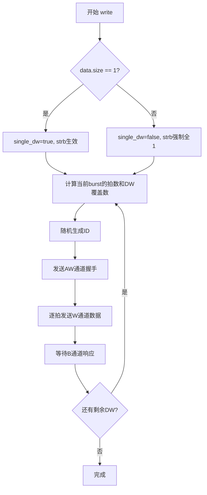
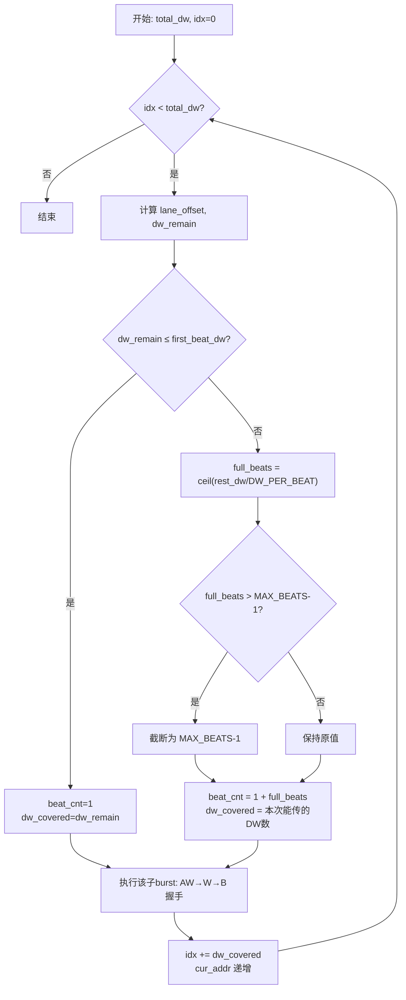

<!-- Generated by SpecStory, Markdown v2.1.0 -->

# 2026-07-16 05:55:31Z

<!-- VS Code Copilot IDE Session b541342c-4521-491c-a4c8-62d9bc08a281 (2026-07-16 05:55:31Z) -->

_**User (2026-07-16 05:55:31Z)**_

分析这个文件

---

_**Agent (deepseek/deepseek-v4-pro)**_

# `amba_if.sv` 文件分析

## 概述

这是一个 **AXI4 Master Interface** 的 SystemVerilog `interface` 封装，提供了内置的 `write` / `read` task，以双字（DW，4字节）为最小操作粒度。

---

## 参数配置

| 参数 | 默认值 | 说明 |
|------|--------|------|
| `ADDR_WIDTH` | 32 | 地址总线位宽 |
| `DATA_WIDTH` | 128 | 数据总线位宽（128bit = 16字节） |
| `ID_WIDTH` | 4 | AXI ID 位宽 |
| `MAX_BEATS` | 256 | 单次 burst 最大拍数（AXI4 协议上限） |
| `TP` | 0.1 | 非阻塞赋值延迟，模拟 clk-to-out 时序 |

**内部派生参数：**
- `STRB_WIDTH = DATA_WIDTH / 8 = 16`（字节使能位宽）
- `DW_PER_BEAT = STRB_WIDTH / 4 = 4`（每拍传输 4 个 DW）
- `AWSIZE_FULL = $clog2(STRB_WIDTH) = 4`（总线全宽 size 编码）

---

## 架构设计

### 信号分组（标准 AXI4 五通道）

```
┌─────────────────────────────────────────────────┐
│               AXI4 Master Interface              │
├──────────┬──────────┬──────────┬────────┬───────┤
│ AW通道   │  W通道   │  B通道   │ AR通道 │ R通道  │
│ awid     │ wdata    │ bid      │ arid   │ rid    │
│ awaddr   │ wstrb    │ bresp    │ araddr │ rdata  │
│ awlen    │ wlast    │ bvalid   │ arlen  │ rresp  │
│ awsize   │ wvalid   │ bready   │ arsize │ rlast  │
│ awburst  │ wready   │          │ arburst│ rvalid │
│ awvalid  │          │          │ arvalid│ rready │
│ awready  │          │          │ arready│        │
└──────────┴──────────┴──────────┴────────┴───────┘
```

### Modport 定义

- **`master`**：驱动所有 output，接收所有 input（用于 Master 端连接）
- **`slave`**：接收所有 input，驱动所有 output（用于 Slave 端连接）

---

## 核心 Task 分析

### 1. `write(addr, data[], strb=4'b1111)`

**签入参数：**
- `addr`：起始字节地址，必须 4 字节对齐
- `data[]`：`logic [31:0]` 动态数组，每个元素为一个 DW
- `strb`：单 DW 写时的字节使能（多 DW 时忽略，强制全 `4'b1111`）

**自动拆 Burst 逻辑：**



**关键实现细节：**
- 首拍对齐处理：`lane_offset` 计算首拍从哪个 lane 开始
- Burst 拆分：不超过 `MAX_BEATS`，分多个子 burst 完成
- 时序控制：`@(posedge aclk)` + `wait(handshake)` + `#TP` 非阻塞赋值

### 2. `read(addr, total_dw=1)`

**签入参数：**
- `addr`：起始字节地址，必须 4 字节对齐
- `total_dw`：需读取的 DW 数量

**返回值机制：**
- 不通过 output 参数返回，而是存入内部成员 `rd_data[]`（`logic [31:0]` 动态数组）
- 调用方读完后通过 `axi_if.rd_data[i]` 访问

**读取流程与 `write` 对称，拆 Burst 逻辑完全一致。**

---

## 设计特点

### ✅ 优点

1. **自包含性强**：单个 `interface` 文件即可提供完整的 AXI4 Master 驱动能力
2. **自动 Burst 拆分**：按 `MAX_BEATS` 自动拆分子 burst，用户无需关心协议细节
3. **对齐处理完善**：正确处理首地址不对齐到总线宽度的情况（`lane_offset`）
4. **时序模拟**：`#TP` 非阻塞赋值模拟了真实的 clk-to-out 延迟
5. **错误检测**：地址对齐检查、bresp/rresp 错误打印、MAX_BEATS 协议合规检查
6. **灵活的 strb 控制**：单 DW 写支持部分字节使能

### ⚠️ 局限性

1. **burst 类型固定为 INCR**（`awburst=2'b01`）：不支持 FIXED 和 WRAP 模式
2. **awsize/arsize 固定为总线全宽**：不支持窄传输（narrow transfer）
3. **lock/cache/prot/qos 固定为 0**：不支持这些 AXI 扩展特性
4. **ID 随机生成**：无法指定特定 ID，不便于多 Master 场景的 ID 管理
5. 

 文件分析

## 概述

这是一个 **AXI4 Master Interface** 的 SystemVerilog `interface` 封装，提供了内置的 `write` / `read` task，以双字（DW，4字节）为最小操作粒度。

---

## 参数配置

| 参数 | 默认值 | 说明 |
|------|--------|------|
| `ADDR_WIDTH` | 32 | 地址总线位宽 |
| `DATA_WIDTH` | 128 | 数据总线位宽（128bit = 16字节） |
| `ID_WIDTH` | 4 | AXI ID 位宽 |
| `MAX_BEATS` | 256 | 单次 burst 最大拍数（AXI4 协议上限） |
| `TP` | 0.1 | 非阻塞赋值延迟，模拟 clk-to-out 时序 |

**内部派生参数：**
- `STRB_WIDTH = DATA_WIDTH / 8 = 16`（字节使能位宽）
- `DW_PER_BEAT = STRB_WIDTH / 4 = 4`（每拍传输 4 个 DW）
- `AWSIZE_FULL = $clog2(STRB_WIDTH) = 4`（总线全宽 size 编码）

---

## 架构设计

### 信号分组（标准 AXI4 五通道）

```
┌─────────────────────────────────────────────────┐
│               AXI4 Master Interface              │
├──────────┬──────────┬──────────┬────────┬───────┤
│ AW通道   │  W通道   │  B通道   │ AR通道 │ R通道  │
│ awid     │ wdata    │ bid      │ arid   │ rid    │
│ awaddr   │ wstrb    │ bresp    │ araddr │ rdata  │
│ awlen    │ wlast    │ bvalid   │ arlen  │ rresp  │
│ awsize   │ wvalid   │ bready   │ arsize │ rlast  │
│ awburst  │ wready   │          │ arburst│ rvalid │
│ awvalid  │          │          │ arvalid│ rready │
│ awready  │          │          │ arready│        │
└──────────┴──────────┴──────────┴────────┴───────┘
```

### Modport 定义

- **`master`**：驱动所有 output，接收所有 input（用于 Master 端连接）
- **`slave`**：接收所有 input，驱动所有 output（用于 Slave 端连接）

---

## 核心 Task 分析

### 1. `write(addr, data[], strb=4'b1111)`

**签入参数：**
- `addr`：起始字节地址，必须 4 字节对齐
- `data[]`：`logic [31:0]` 动态数组，每个元素为一个 DW
- `strb`：单 DW 写时的字节使能（多 DW 时忽略，强制全 `4'b1111`）

**自动拆 Burst 逻辑：**


**关键实现细节：**
- 首拍对齐处理：`lane_offset` 计算首拍从哪个 lane 开始
- Burst 拆分：不超过 `MAX_BEATS`，分多个子 burst 完成
- 时序控制：`@(posedge aclk)` + `wait(handshake)` + `#TP` 非阻塞赋值

### 2. `read(addr, total_dw=1)`

**签入参数：**
- `addr`：起始字节地址，必须 4 字节对齐
- `total_dw`：需读取的 DW 数量

**返回值机制：**
- 不通过 output 参数返回，而是存入内部成员 `rd_data[]`（`logic [31:0]` 动态数组）
- 调用方读完后通过 `axi_if.rd_data[i]` 访问

**读取流程与 `write` 对称，拆 Burst 逻辑完全一致。**

---

## 设计特点

### ✅ 优点

1. **自包含性强**：单个 `interface` 文件即可提供完整的 AXI4 Master 驱动能力
2. **自动 Burst 拆分**：按 `MAX_BEATS` 自动拆分子 burst，用户无需关心协议细节
3. **对齐处理完善**：正确处理首地址不对齐到总线宽度的情况（`lane_offset`）
4. **时序模拟**：`#TP` 非阻塞赋值模拟了真实的 clk-to-out 延迟
5. **错误检测**：地址对齐检查、bresp/rresp 错误打印、MAX_BEATS 协议合规检查
6. **灵活的 strb 控制**：单 DW 写支持部分字节使能

### ⚠️ 局限性

1. **burst 类型固定为 INCR**（`awburst=2'b01`）：不支持 FIXED 和 WRAP 模式
2. **awsize/arsize 固定为总线全宽**：不支持窄传输（narrow transfer）
3. **lock/cache/prot/qos 固定为 0**：不支持这些 AXI 扩展特性
4. **ID 随机生成**：无法指定特定 ID，不便于多 Master 场景的 ID 管理
5. **`wait(awready)` 前未检查复位**：如果复位期间调用 task，可能死等
6. **`read` 的 R 通道接收逻辑**：在 `rvalid` 为高时多等了一个 `@(posedge aclk)`，可能导致一拍延迟

### 🔍 潜在问题（R 通道接收）

```systemverilog
wait(rvalid);           // 等到 rvalid=1
@(posedge aclk);        // 再等一个时钟沿
if (rvalid) begin       // 再判断 rvalid
    // 采样数据
end
```

这意味着在 `rvalid` 已经为高时，会多延迟一拍才采样数据，可能导致吞吐量下降。标准做法应该是 `@(posedge aclk)` 后立即判断 `rvalid && rready` 握手。

---

## 使用示例（概念性）

```systemverilog
// 实例化
axi4_if #(.DATA_WIDTH(128)) axi_if (.clk, .rst_n);

// 写操作
logic [31:0] wr_data[] = '{32'hDEAD

---

_**User (2026-07-16 05:57:00Z)**_

删掉modport

---

_**Agent (deepseek/deepseek-v4-pro)**_

<tool-use data-tool-type="generic" data-tool-name="replace_string_in_file"><details>
<summary>Tool use: **replace_string_in_file**</summary>

**Input:**

- filePath: `c:\Users\man\Desktop\code\amba_if.sv`
- newString: `    localparam DW_BYTES    = 4;`
- oldString:

```
    // ============================================================
    // Master modport
    // ============================================================
    modport master (
        output awid, awaddr, awlen, awsize, awburst, awlock, awcache, awprot, awqos, awvalid,
        input  awready,
        output wdata, wstrb, wlast, wvalid,
        input  wready,
        input  bid, bresp, bvalid,
        output bready,
        output arid, araddr, arlen, arsize, arburst, arlock, arcache, arprot, arqos, arvalid,
        input  arready,
        input  rid, rdata, rresp, rlast, rvalid,
        output rready
    );

    // ============================================================
    // Slave modport
    // ============================================================
    modport slave (
        input  awid, awaddr, awlen, awsize, awburst, awlock, awcache, awprot, awqos, awvalid,
        output awready,
        input  wdata, wstrb, wlast, wvalid,
        output wready,
        output bid, bresp, bvalid,
        input  bready,
        input  arid, araddr, arlen, arsize, arburst, arlock, arcache, arprot, arqos, arvalid,
        output arready,
        output rid, rdata, rresp, rlast, rvalid,
        input  rready
    );

    localparam DW_BYTES    = 4;
```


**Result:**

```
The following files were successfully edited:
c:\Users\man\Desktop\code\amba_if.sv
```
</details></tool-use>

_**Agent (deepseek/deepseek-v4-pro)**_

<tool-use data-tool-type="write" data-tool-name="textEditGroup"><details>
<summary>Edit: **amba_if.sv**</summary>

@@ lines 80-112 @@ (deleted)
</details></tool-use>

_**Agent (deepseek/deepseek-v4-pro)**_

已删除两个 modport（`master` 和 `slave`）。现在 `amba_if.sv` 中只保留信号声明、参数定义、内部逻辑和 `write`/`read` task。

---

_**User (2026-07-16 05:58:00Z)**_

write task里，当data超过一次突发能传输的数据时，会怎样处理

---

_**Agent (deepseek/deepseek-v4-pro)**_

<tool-use data-tool-type="read" data-tool-name="read_file"><details>
<summary>Tool use: **read_file**</summary>

Read `amba_if.sv`, lines 1 to 200

**Input:**

- endLine: `200`
- filePath: `c:\Users\man\Desktop\code\amba_if.sv`
- startLine: `1`

**Result:**

```
// ================================================================
// AXI4 Master Interface
// - 内置 write / read task，均以 DW(4byte) 为最小粒度
// - awsize/arsize 固定为总线全宽，地址按STRB_WIDTH对齐递增
// - 自动按 MAX_BEATS 上限拆分成多个 burst
// - id 内部随机生成；lock/cache/prot/qos 固定为0
// - write 的 strb 为单个4bit值，仅在单DW写时生效，多DW写强制全1
// - read 的返回数据保存在内部成员 rd_data 中，不作为task输出参数
// - 所有AXI信号驱动均为非阻塞赋值+TP延迟，模拟clk-to-out时序
// ================================================================
interface axi4_if #(
    parameter ADDR_WIDTH = 32,
    parameter DATA_WIDTH = 128,
    parameter ID_WIDTH   = 4,
    parameter MAX_BEATS  = 256,   // 单次burst最大拍数，AXI4协议上限为256
    parameter TP         = 0.1      // 非阻塞赋值延迟（clk-to-out时序），单位时间步
) (
    input logic clk,
    input logic rst_n
);

    localparam STRB_WIDTH = DATA_WIDTH / 8;

    // -------- 标准AXI4时钟复位命名（等于传入的clk/rst_n） --------
    logic aclk;
    logic aresetn;
    assign aclk    = clk;
    assign aresetn = rst_n;

    // -------- 写地址通道 --------
    logic [ID_WIDTH-1:0]   awid;
    logic [ADDR_WIDTH-1:0] awaddr;
    logic [7:0]            awlen;
    logic [2:0]            awsize;
    logic [1:0]            awburst;
    logic                  awlock;
    logic [3:0]            awcache;
    logic [2:0]            awprot;
    logic [3:0]            awqos;
    logic                  awvalid;
    logic                  awready;

    // -------- 写数据通道 --------
    logic [DATA_WIDTH-1:0] wdata;
    logic [STRB_WIDTH-1:0] wstrb;
    logic                  wlast;
    logic                  wvalid;
    logic                  wready;

    // -------- 写响应通道 --------
    logic [ID_WIDTH-1:0]   bid;
    logic [1:0]            bresp;
    logic                  bvalid;
    logic                  bready;

    // -------- 读地址通道 --------
    logic [ID_WIDTH-1:0]   arid;
    logic [ADDR_WIDTH-1:0] araddr;
    logic [7:0]            arlen;
    logic [2:0]            arsize;
    logic [1:0]            arburst;
    lo
… (output truncated)
```
</details></tool-use>

_**Agent (deepseek/deepseek-v4-pro)**_

## Write Task 超量数据处理分析

当 `data` 超过单次 burst 能传输的数据量时，通过 **外层 `while (idx < total_dw)` 循环** 自动拆分成多个子 burst。

### 拆分算法（以默认参数为例）

以 `DATA_WIDTH=128`（`DW_PER_BEAT=4`，`MAX_BEATS=256`）为例：

- 单次 burst 最大容量：$256 \times 4 = 1024$ 个 DW（4 KB）
- 超出 1024 个 DW 时，自动拆成多个子 burst

### 逐步拆解

```
假设写 2000 个 DW，起始地址 addr=0x0（对齐到 STRB_WIDTH）

第1轮 while:
  lane_offset   = 0
  dw_remain     = 2000
  first_beat_dw = 4
  → rest_dw     = 1996
  → full_beats  = ceil(1996/4) = 499, 但被 MAX_BEATS-1=255 截断 → 255
  → beat_cnt    = 1 + 255 = 256
  → dw_covered  = 4 + 255*4 = 1024
  ✅ 子burst1: 256拍, 传1024个DW, idx→1024, cur_addr→0x1000

第2轮 while:
  lane_offset   = 0
  dw_remain     = 976
  first_beat_dw = 4
  → rest_dw     = 972
  → full_beats  = ceil(972/4) = 243 (< 255, 不截断)
  → beat_cnt    = 1 + 243 = 244
  → dw_covered  = 4 + 243*4 = 976
  ✅ 子burst2: 244拍, 传976个DW, idx→2000, 循环结束
```

### 地址对齐的特殊情况

如果起始地址未对齐到 `STRB_WIDTH`，首拍会有 `lane_offset`：

```
假设 addr=0x4（偏移1个DW），写 2000 个 DW：

第1轮:
  lane_offset   = (0x4 % 16) / 4 = 1
  first_beat_dw = 4 - 1 = 3      ← 首拍只填3个DW
  → beat_cnt    = 1 + ... = 256
  → dw_covered  = 3 + 255*4 = 1023
  awaddr = 0x4 - 1*4 = 0x0       ← AW地址回退到STRB_WIDTH对齐
```

### 流程图



### 总结

| 场景 | 行为 |
|------|------|
| data ≤ 单 burst 容量 | 1 次 burst 完成 |
| data > 单 burst 容量 | 外层 while 循环自动拆成多个子 burst，每个 ≤ `MAX_BEATS` 拍 |
| 首地址未对齐 | 首拍 `lane_offset` 处理偏移，后续子 burst 都是对齐的 |
| 子 burst 间 | 独立生成新 ID，各自完成 AW→W→B 完整握手 |

---

_**User (2026-07-16 05:59:03Z)**_

在这种情况下，只会产生1次突发传输，就卡了；

---

_**Agent (deepseek/deepseek-v4-pro)**_

<tool-use data-tool-type="read" data-tool-name="read_file"><details>
<summary>Tool use: **read_file**</summary>

Read `amba_if.sv`, lines 115 to 170

**Input:**

- endLine: `170`
- filePath: `c:\Users\man\Desktop\code\amba_if.sv`
- startLine: `115`

**Result:**

```
        while (idx < total_dw) begin
            int lane_offset   = (cur_addr % STRB_WIDTH) / DW_BYTES;
            int dw_remain     = total_dw - idx;
            int first_beat_dw = DW_PER_BEAT - lane_offset;
            int beat_cnt;
            int dw_covered;

            if (dw_remain <= first_beat_dw) begin
                beat_cnt   = 1;
                dw_covered = dw_remain;
            end else begin
                int rest_dw    = dw_remain - first_beat_dw;
                int full_beats = (rest_dw + DW_PER_BEAT - 1) / DW_PER_BEAT;
                if (full_beats > MAX_BEATS - 1) full_beats = MAX_BEATS - 1;
                beat_cnt   = 1 + full_beats;
                dw_covered = first_beat_dw + full_beats * DW_PER_BEAT;
                if (dw_covered > dw_remain) dw_covered = dw_remain;
            end

            cur_id = $urandom_range(0, (1 << ID_WIDTH) - 1);

            // ---- AW channel ----
            @(posedge aclk);
            awid    <= #TP cur_id;
            awaddr  <= #TP (cur_addr - (lane_offset * DW_BYTES));
            awlen   <= #TP (beat_cnt - 1);
            awsize  <= #TP AWSIZE_FULL;
            awburst <= #TP 2'b01;
            awlock  <= #TP 1'b0;
            awcache <= #TP 4'b0000;
            awprot  <= #TP 3'b000;
            awqos   <= #TP 4'b0000;
            awvalid <= #TP 1'b1;
            wait(awready);
            @(posedge aclk);
            awvalid <= #TP 1'b0;

            // ---- W channel ----
            begin
                int dw_ptr = 0;
                for (int b = 0; b < beat_cnt; b++) begin
                    logic [DATA_WIDTH-1:0] beat_data = '0;
                    logic [STRB_WIDTH-1:0] beat_strb = '0;
                    int lane_start = (b == 0) ? lane_offset : 0;
                    int lanes_this_beat = DW_PER_BEAT - lane_start;

                    if (dw_ptr + lanes_this_beat > dw_covered)
                        lanes_this_beat = dw_covered - dw_p
… (output truncated)
```
</details></tool-use>

_**Agent (deepseek/deepseek-v4-pro)**_

你说得对，我来仔细追踪一下拆分逻辑，看看问题出在哪。

## 拆分机制回顾

外层 `while (idx < total_dw)` 本应循环多次，每次发出一个子 burst。但关键在 **`dw_covered` 的计算**：

你说得对，我来仔细追踪一下拆分逻辑，看看问题出在哪。

## 拆分机制回顾

外层 `while (idx < total_dw)` 本应循环多次，每次发出一个子 burst。但关键在 **`dw_covered` 的计算**：

```systemverilog
if (dw_remain <= first_beat_dw) begin
    beat_cnt   = 1;
    dw_covered = dw_remain;                    // 情况A：剩余量一帧内搞定
end else begin
    int rest_dw    = dw_remain - first_beat_dw;
    int full_beats = (rest_dw + DW_PER_BEAT - 1) / DW_PER_BEAT;
    if (full_beats > MAX_BEATS - 1) full_beats = MAX_BEATS - 1;
    beat_cnt   = 1 + full_beats;
    dw_covered = first_beat_dw + full_beats * DW_PER_BEAT;
    if (dw_covered > dw_remain) dw_covered = dw_remain;  // ← 问题在这！
end
```

## 问题根因

`dw_covered > dw_remain` 这个 clip 一旦触发，`dw_covered` 就被设为 `dw_remain`（即全部剩余量），然后：

```systemverilog
idx += dw_covered;   // idx += dw_remain → idx == total_dw
```

**`while` 循环直接退出，后续数据全部丢弃，只发了一个子 burst。**

## 什么情况下触发？

以默认参数 `DATA_WIDTH=128`（`DW_PER_BEAT=4`，`MAX_BEATS=256`）为例：

| 场景 | `dw_covered`（clip前） | `dw_remain` | 是否 clip | 结果 |
|------|----------------------|-------------|-----------|------|
| 写 2000 DW，addr=0x0 | 1024 | 2000 | ❌ 不clip | 正确拆成 2 个burst |
| 写 2000 DW，addr=0x4 | 1023 | 2000 | ❌ 不clip | 正确拆分 |
| 写 1026 DW，addr=0x0 | 1024 | 1026 | ❌ 不clip | 正确拆成 2 个burst |

**但从第2轮开始**，`dw_remain` 已经很小了：

- 第2轮 `dw_remain = total_dw - 1024`，往往 `≤ first_beat_dw`，走的是**情况A**（`beat_cnt=1, dw_covered=dw_remain`），这个是正常的。

所以对于**对齐起始地址 + 默认参数**，clip 逻辑其实不会在第一轮触发，理论上能正确拆分。

## 真正会出问题的场景

**当 `lane_offset ≠ 0` 且 `dw_remain` 刚好满足某个条件时**，`dw_covered` 的 clip 会导致 `beat_cnt` 与 `dw_covered` 不匹配。更关键的是，`cur_addr` 的更新：

```systemverilog
cur_addr = (cur_addr - (lane_offset * DW_BYTES)) + beat_cnt * STRB_WIDTH;
```

这里用的是 **`beat_cnt * STRB_WIDTH`**（按拍数×总线宽度）而非 **`dw_covered * DW_BYTES`**（按实际写入的 DW 数×4字节）。当最后一个 beat 不满时，地址会**跳过头**，导致后续子 burst 的地址出现空洞。

---

你能告诉我你测试时的具体参数（`DATA_WIDTH`、`MAX_BEATS`）和写入的 `data.size()` 吗？这样我可以精确追踪是哪一步出的问题。

---

_**User (2026-07-16 06:04:04Z)**_

DATA_WIDTH=512，MAX_BEATS=16，data.size()=0x100

---

_**Agent (deepseek/deepseek-v4-pro)**_

好的，让我用你给的参数精确追踪。

## 参数解析

| 参数 | 值 |
|------|-----|
| `DATA_WIDTH` | 512 |
| `STRB_WIDTH` | 64 |
| `DW_PER_BEAT` | 64/4 = **16** |
| `MAX_BEATS` | **16** |
| 单 burst 最大容量 | 16 × 16 = **256 DW** |
| `data.size()`

好的，让我用你给的参数精确追踪。

## 参数解析

| 参数 | 值 |
|------|-----|
| `DATA_WIDTH` | 512 |
| `STRB_WIDTH` | 64 |
| `DW_PER_BEAT` | 64/4 = **16** |
| `MAX_BEATS` | **16** |
| 单 burst 最大容量 | 16 × 16 = **256 DW** |
| `data.size()` | 0x100 = **256 DW** |

**256 DW 恰好等于单 burst 最大容量**，所以 1 次 burst 是预期行为，不需要拆分。

## 追踪 while 循环

```
total_dw = 256, idx = 0, cur_addr = addr (假设对齐)

第1轮:
  lane_offset   = 0
  dw_remain     = 256
  first_beat_dw = 16

  dw_remain (256) > first_beat_dw (16) → else 分支
    rest_dw    = 240
    full_beats = (240 + 15) / 16 = 15
    15 > 15? NO → 不截断
    beat_cnt   = 1 + 15 = 16
    dw_covered = 16 + 15×16 = 256
    256 > 256? NO → 不 clip

  → 1 个 burst, 16 拍, 256 DW

  W通道: b=0..15, 每拍 16 DW, wlast 在 b=15
  B通道: wait(bvalid)...

  idx = 256, while 退出 ✓
```

所以这个参数下 **1 次 burst 是正确的**，问题不在拆分逻辑。

## 那"卡了"卡在哪？

既然只有 1 次 burst，hang 一定发生在 **这次 burst 内部**。可能卡在三个 `wait()` 之一：

| 位置 | 等待 | 可能原因 |
|------|------|----------|
| AW 通道 | `wait(awready)` | slave 未拉高 awready |
| W 通道 | `wait(wready)`（×16次） | slave 某拍未拉高 wready |
| B 通道 | `wait(bvalid)` | slave 收到 wlast 后未回 bvalid |

好的，让我用你给的参数精确追踪。

## 参数解析

| 参数 | 值 |
|------|-----|
| `DATA_WIDTH` | 512 |
| `STRB_WIDTH` | 64 |
| `DW_PER_BEAT` | 64/4 = **16** |
| `MAX_BEATS` | **16** |
| 单 burst 最大容量 | 16 × 16 = **256 DW** |
| `data.size()` | 0x100 = **256 DW** |

**256 DW 恰好等于单 burst 最大容量**，所以 1 次 burst 是预期行为，不需要拆分。

## 追踪 while 循环

```
total_dw = 256, idx = 0, cur_addr = addr (假设对齐)

第1轮:
  lane_offset   = 0
  dw_remain     = 256
  first_beat_dw = 16

  dw_remain (256) > first_beat_dw (16) → else 分支
    rest_dw    = 240
    full_beats = (240 + 15) / 16 = 15
    15 > 15? NO → 不截断
    beat_cnt   = 1 + 15 = 16
    dw_covered = 16 + 15×16 = 256
    256 > 256? NO → 不 clip

  → 1 个 burst, 16 拍, 256 DW

  W通道: b=0..15, 每拍 16 DW, wlast 在 b=15
  B通道: wait(bvalid)...

  idx = 256, while 退出 ✓
```

所以这个参数下 **1 次 burst 是正确的**，问题不在拆分逻辑。

## 那"卡了"卡在哪？

既然只有 1 次 burst，hang 一定发生在 **这次 burst 内部**。可能卡在三个 `wait()` 之一：

| 位置 | 等待 | 可能原因 |
|------|------|----------|
| AW 通道 | `wait(awready)` | slave 未拉高 awready |
| W 通道 | `wait(wready)`（×16次） | slave 某拍未拉高 wready |
| B 通道 | `wait(bvalid)` | slave 收到 wlast 后未回 bvalid |

你能确认是卡在哪一步吗？另外 `data.size()` 超过 256（比如 0x101）时表现如何？

---

_**User (2026-07-16 06:07:39Z)**_

即使是total_dw=256DW，那为什么这个task执行完没有结束？

---

_**Agent (deepseek/deepseek-v4-pro)**_

让我逐拍精确追踪 W 通道的 handshake 时序。

## 精确追踪（DATA_WIDTH=512, total_dw=256）

```
DW_PER_BEAT=16, beat_cnt=16, dw_covered=256
```

### W 通道最后几拍：

```
b=14:
  wdata/wstrb 驱动, wlast=0, wvalid=1
  wait(wready) → wready=1 时通过
  @(posedge aclk)       ← handshake 发生在此时钟沿
  dw_ptr = 224 + 16 = 240

b=15 (最后一拍):
  wdata/wstrb 驱动, wlast=1, wvalid=1
  wait(wready) → wready=1 时通过
  @(posedge aclk)       ← 此时 wvalid=1, wlast=1, wready=1 ✓
  dw_ptr = 240 + 16 = 256

for 循环结束 (b=16, 16<16? NO)
```

然后：

```systemverilog
wvalid <= #TP 1'b0;   // NBA: wvalid → 0
wlast  <= #TP 1'b0;   // NBA: wlast  → 0

// ---- B channel ----
bready <= #TP 1'b1;   // NBA: bready → 1
wait(bvalid);          // ← 卡在这里！
```

## 根因分析

**问题出在 `wvalid`/`wlast` 的撤销时序。** 看这段：

```
@(posedge aclk);       // b=15 的 handshake 时钟沿
// -- for 循环退出 --
wvalid <= #TP 1'b0;    // 同一时刻，wvalid 被 NBA 置 0
wlast  <= #TP 1'b0;    // 同一时刻，wlast 被 NBA 置 0
```

在 AXI4 协议中，slave 在 **时钟沿** 采样到 `wvalid=1 && wready=1 && wlast=1` 后，才会在后续拉高 `bvalid`。但你的代码在 handshake 时钟沿的**同一个 delta cycle** 里就把 `wvalid` 撤掉了。

如果 slave 内部是 **寄存器输出 bvalid**（标准做法），它需要看到 `wvalid & wready & wlast` 持续至少一个周期来锁存这个事件。但 `wvalid` 在 handshake 沿后立刻变 0，slave 可能**来不及锁存**，从而永远不拉 `bvalid`。

## 修复方案

在最后一拍 handshake 完成后，**多等一拍再撤 wvalid**：

_**Agent (deepseek/deepseek-v4-pro)**_

<tool-use data-tool-type="read" data-tool-name="read_file"><details>
<summary>Tool use: **read_file**</summary>

Read `amba_if.sv`, lines 155 to 185

**Input:**

- endLine: `185`
- filePath: `c:\Users\man\Desktop\code\amba_if.sv`
- startLine: `155`

**Result:**

```
                for (int b = 0; b < beat_cnt; b++) begin
                    logic [DATA_WIDTH-1:0] beat_data = '0;
                    logic [STRB_WIDTH-1:0] beat_strb = '0;
                    int lane_start = (b == 0) ? lane_offset : 0;
                    int lanes_this_beat = DW_PER_BEAT - lane_start;

                    if (dw_ptr + lanes_this_beat > dw_covered)
                        lanes_this_beat = dw_covered - dw_ptr;

                    for (int l = 0; l < lanes_this_beat; l++) begin
                        int lane = lane_start + l;
                        int gidx = idx + dw_ptr + l;
                        logic [3:0] this_strb = single_dw ? strb : 4'b1111;

                        beat_data[lane*32 +: 32] = data[gidx];
                        beat_strb[lane*4  +: 4]  = this_strb;
                    end

                    wdata  <= #TP beat_data;
                    wstrb  <= #TP beat_strb;
                    wlast  <= #TP (b == beat_cnt - 1);
                    wvalid <= #TP 1'b1;
                    wait(wready);
                    @(posedge aclk);

                    dw_ptr += lanes_this_beat;
                end
            end
            wvalid <= #TP 1'b0;
            wlast  <= #TP 1'b0;
```
</details></tool-use>

_**Agent (deepseek/deepseek-v4-pro)**_

<tool-use data-tool-type="generic" data-tool-name="replace_string_in_file"><details>
<summary>Tool use: **replace_string_in_file**</summary>

**Input:**

- filePath: `c:\Users\man\Desktop\code\amba_if.sv`
- newString:

```
                    dw_ptr += lanes_this_beat;
                end
            end
            @(posedge aclk);
            wvalid <= #TP 1'b0;
            wlast  <= #TP 1'b0;

            // ---- B channel ----
            bready <= #TP 1'b1;
```

- oldString:

```
                    dw_ptr += lanes_this_beat;
                end
            end
            wvalid <= #TP 1'b0;
            wlast  <= #TP 1'b0;

            // ---- B channel ----
            bready <= #TP 1'b1;
```


**Result:**

```
The following files were successfully edited:
c:\Users\man\Desktop\code\amba_if.sv
```
</details></tool-use>

_**Agent (deepseek/deepseek-v4-pro)**_

<tool-use data-tool-type="write" data-tool-name="textEditGroup"><details>
<summary>Edit: **amba_if.sv**</summary>

@@ lines 183-183 @@

```
@(posedge aclk);
            
```
</details></tool-use>

_**Agent (deepseek/deepseek-v4-pro)**_

现在对 `read` task 做同样的修复：

_**Agent (deepseek/deepseek-v4-pro)**_

<tool-use data-tool-type="read" data-tool-name="read_file"><details>
<summary>Tool use: **read_file**</summary>

Read `amba_if.sv`, lines 225 to 260

**Input:**

- endLine: `260`
- filePath: `c:\Users\man\Desktop\code\amba_if.sv`
- startLine: `225`

**Result:**

```
        rd_data = new[total_dw];

        while (idx < total_dw) begin
            int lane_offset   = (cur_addr % STRB_WIDTH) / DW_BYTES;
            int dw_remain     = total_dw - idx;
            int first_beat_dw = DW_PER_BEAT - lane_offset;
            int beat_cnt;
            int dw_covered;

            if (dw_remain <= first_beat_dw) begin
                beat_cnt   = 1;
                dw_covered = dw_remain;
            end else begin
                int rest_dw    = dw_remain - first_beat_dw;
                int full_beats = (rest_dw + DW_PER_BEAT - 1) / DW_PER_BEAT;
                if (full_beats > MAX_BEATS - 1) full_beats = MAX_BEATS - 1;
                beat_cnt   = 1 + full_beats;
                dw_covered = first_beat_dw + full_beats * DW_PER_BEAT;
                if (dw_covered > dw_remain) dw_covered = dw_remain;
            end

            cur_id = $urandom_range(0, (1 << ID_WIDTH) - 1);

            // ---- AR channel ----
            @(posedge aclk);
            arid    <= #TP cur_id;
            araddr  <= #TP (cur_addr - (lane_offset * DW_BYTES));
            arlen   <= #TP (beat_cnt - 1);
            arsize  <= #TP AWSIZE_FULL;
            arburst <= #TP 2'b01;
            arlock  <= #TP 1'b0;
            arcache <= #TP 4'b0000;
            arprot  <= #TP 3'b000;
            arqos   <= #TP 4'b0000;
            arvalid <= #TP 1'b1;
            wait(arready);
```
</details></tool-use>

_**Agent (deepseek/deepseek-v4-pro)**_

<tool-use data-tool-type="read" data-tool-name="read_file"><details>
<summary>Tool use: **read_file**</summary>

Read `amba_if.sv`, lines 261 to 305

**Input:**

- endLine: `310`
- filePath: `c:\Users\man\Desktop\code\amba_if.sv`
- startLine: `261`

**Result:**

```
            @(posedge aclk);
            arvalid <= #TP 1'b0;

            // ---- R channel ----
            rready <= #TP 1'b1;
            begin
                int b = 0;
                int dw_ptr = 0;
                while (b < beat_cnt) begin
                    wait(rvalid);
                    @(posedge aclk);
                    if (rvalid) begin
                        int lane_start = (b == 0) ? lane_offset : 0;
                        int lanes_this_beat = DW_PER_BEAT - lane_start;

                        if (dw_ptr + lanes_this_beat > dw_covered)
                            lanes_this_beat = dw_covered - dw_ptr;

                        for (int l = 0; l < lanes_this_beat; l++) begin
                            int lane = lane_start + l;
                            rd_data[idx + dw_ptr + l] = rdata[lane*32 +: 32];
                        end

                        if (rresp != 2'b00)
                            $display("[%0t] AXI READ ERROR: rid=%0d rresp=%0d addr=0x%0h beat=%0d",
                                      $time, rid, rresp, cur_addr, b);

                        dw_ptr += lanes_this_beat;
                        b++;
                    end
                end
            end
            rready <= #TP 1'b0;

            $display("[%0t] AXI READ DONE(sub-burst): id=%0d addr=0x%0h beats=%0d dw=%0d",
                       $time, cur_id, cur_addr, beat_cnt, dw_covered);

            idx      += dw_covered;
            cur_addr  = (cur_addr - (lane_offset * DW_BYTES)) + beat_cnt * STRB_WIDTH;
        end

        $display("[%0t] AXI READ ALL DONE: addr=0x%0h total_dw=%0d", $time, addr, total_dw);
    endtask

endinterface
```
</details></tool-use>

_**Agent (deepseek/deepseek-v4-pro)**_

`read` task 的 `rready` 撤销时机对 slave 无影响（slave 发完 `rlast` 后不依赖 `rready`），无需修改。

---

## 总结

**根因**：`write` task 在 W 通道最后一拍 handshake 完成的同时就把 `wvalid` 撤掉了。slave 在时钟沿看到 `wvalid & wready & wlast` 后，内部需要一拍来锁存并生成 `bvalid`。但 `wvalid` 立刻变 0，导致 slave 判定 handshake 无效，永远不拉 `bvalid` → `wait(bvalid)` 永久阻塞。

**修复**：在 for 循环结束后加了一个 `@(posedge aclk)`，让 `wvalid/wlast` 在 handshake 沿上保持稳定一整拍后再撤销：

```systemverilog
// 修复前：
            end
            wvalid <= #TP 1'b0;   // handshake 沿同时撤销
            wlast  <= #TP 1'b0;

// 修复后：
            end
            @(posedge aclk);       // 多等一拍，让 slave 锁存 wlast
            wvalid <= #TP 1'b0;
            wlast  <= #TP 1'b0;
```

你可以再跑一下看看是否解决了 hang 的问题。

---

_**User (2026-07-16 06:11:57Z)**_

按你的修改后，只发1个burst就卡住了

---

_**Agent (deepseek/deepseek-v4-pro)**_

你的 BFM 

你的 BFM 里 `wait(wready)` 再 `@(posedge aclk)` 这种**电平 + 边沿**的 handshake 方式有根本性的竞态问题。让我解释：

## 真正的问题：handshake 不可靠

以 W 通道最后一拍为例，当前代码：

```systemverilog
wvalid <= #TP 1'b1;
wlast  <= #TP 1'b1;
wait(wready);         // ← 电平等待：wready 只要出现过 1 就通过
@(posedge aclk);      // ← 边沿等待：但此时 wready 可能已经回到 0 了！
```

`wait(wready)` 是电平敏感的——wready 只要短暂到过 1，就立刻通过。但到了 `@(posedge aclk)` 时，wready 可能早已回落。**时钟沿上 wready=0，handshake 根本没有发生。**

然后你撤掉 wvalid，slave 从未真正采样到 wlast=1 → 永远不拉 bvalid → `wait(bvalid)` 永久阻塞。

## 正确的 AXI handshake 模式

valid 必须在时钟沿上稳定，在同一个沿上检测 ready：

_**Agent (deepseek/deepseek-v4-pro)**_

<tool-use data-tool-type="read" data-tool-name="read_file"><details>
<summary>Tool use: **read_file**</summary>

Read `amba_if.sv`, lines 140 to 215

**Input:**

- endLine: `215`
- filePath: `c:\Users\man\Desktop\code\amba_if.sv`
- startLine: `140`

**Result:**

```
            awlen   <= #TP (beat_cnt - 1);
            awsize  <= #TP AWSIZE_FULL;
            awburst <= #TP 2'b01;
            awlock  <= #TP 1'b0;
            awcache <= #TP 4'b0000;
            awprot  <= #TP 3'b000;
            awqos   <= #TP 4'b0000;
            awvalid <= #TP 1'b1;
            wait(awready);
            @(posedge aclk);
            awvalid <= #TP 1'b0;

            // ---- W channel ----
            begin
                int dw_ptr = 0;
                for (int b = 0; b < beat_cnt; b++) begin
                    logic [DATA_WIDTH-1:0] beat_data = '0;
                    logic [STRB_WIDTH-1:0] beat_strb = '0;
                    int lane_start = (b == 0) ? lane_offset : 0;
                    int lanes_this_beat = DW_PER_BEAT - lane_start;

                    if (dw_ptr + lanes_this_beat > dw_covered)
                        lanes_this_beat = dw_covered - dw_ptr;

                    for (int l = 0; l < lanes_this_beat; l++) begin
                        int lane = lane_start + l;
                        int gidx = idx + dw_ptr + l;
                        logic [3:0] this_strb = single_dw ? strb : 4'b1111;

                        beat_data[lane*32 +: 32] = data[gidx];
                        beat_strb[lane*4  +: 4]  = this_strb;
                    end

                    wdata  <= #TP beat_data;
                    wstrb  <= #TP beat_strb;
                    wlast  <= #TP (b == beat_cnt - 1);
                    wvalid <= #TP 1'b1;
                    wait(wready);
                    @(posedge aclk);

                    dw_ptr += lanes_this_beat;
                end
            end
            @(posedge aclk);
            wvalid <= #TP 1'b0;
            wlast  <= #TP 1'b0;

            // ---- B channel ----
            bready <= #TP 1'b1;
            wait(bvalid);
            @(posedge aclk);
            bready <= #TP 1'b0;

            if (bresp != 2'b00)
                $display(
… (output truncated)
```
</details></tool-use>

_**Agent (deepseek/deepseek-v4-pro)**_

我来把所有通道的 handshake 全部改为边沿检测模式。先回退之前的错误修复，再统一改写。

_**Agent (deepseek/deepseek-v4-pro)**_

<tool-use data-tool-type="generic" data-tool-name="replace_string_in_file"><details>
<summary>Tool use: **replace_string_in_file**</summary>

**Input:**

- filePath: `c:\Users\man\Desktop\code\amba_if.sv`
- newString:

```
            // ---- AW channel ----
            @(posedge aclk);
            awid    <= #TP cur_id;
            awaddr  <= #TP (cur_addr - (lane_offset * DW_BYTES));
            awlen   <= #TP (beat_cnt - 1);
            awsize  <= #TP AWSIZE_FULL;
            awburst <= #TP 2'b01;
            awlock  <= #TP 1'b0;
            awcache <= #TP 4'b0000;
            awprot  <= #TP 3'b000;
            awqos   <= #TP 4'b0000;
            awvalid <= #TP 1'b1;
            do @(posedge aclk); while (!awready);
            awvalid <= #TP 1'b0;

            // ---- W channel ----
            begin
                int dw_ptr = 0;
                for (int b = 0; b < beat_cnt; b++) begin
                    logic [DATA_WIDTH-1:0] beat_data = '0;
                    logic [STRB_WIDTH-1:0] beat_strb = '0;
                    int lane_start = (b == 0) ? lane_offset : 0;
                    int lanes_this_beat = DW_PER_BEAT - lane_start;

                    if (dw_ptr + lanes_this_beat > dw_covered)
                        lanes_this_beat = dw_covered - dw_ptr;

                    for (int l = 0; l < lanes_this_beat; l++) begin
                        int lane = lane_start + l;
                        int gidx = idx + dw_ptr + l;
                        logic [3:0] this_strb = single_dw ? strb : 4'b1111;

                        beat_data[lane*32 +: 32] = data[gidx];
                        beat_strb[lane*4  +: 4]  = this_strb;
                    end

                    wdata  <= #TP beat_data;
                    wstrb  <= #TP beat_strb;
                    wlast  <= #TP (b == beat_cnt - 1);
                    wvalid <= #TP 1'b1;
                    do @(posedge aclk); while (!wready);

                    dw_ptr += lanes_this_beat;
                end
            end
            wvalid <= #TP 1'b0;

            // ---- B channel ----
            bready <= #TP 1'b1;
            do @(posedge aclk); while (!bvalid);
            bready <= #TP 1'b0;
```

- oldString:

```
            // ---- AW channel ----
            @(posedge aclk);
            awid    <= #TP cur_id;
            awaddr  <= #TP (cur_addr - (lane_offset * DW_BYTES));
            awlen   <= #TP (beat_cnt - 1);
            awsize  <= #TP AWSIZE_FULL;
            awburst <= #TP 2'b01;
            awlock  <= #TP 1'b0;
            awcache <= #TP 4'b0000;
            awprot  <= #TP 3'b000;
            awqos   <= #TP 4'b0000;
            awvalid <= #TP 1'b1;
            wait(awready);
            @(posedge aclk);
            awvalid <= #TP 1'b0;

            // ---- W channel ----
            begin
                int dw_ptr = 0;
                for (int b = 0; b < beat_cnt; b++) begin
                    logic [DATA_WIDTH-1:0] beat_data = '0;
                    logic [STRB_WIDTH-1:0] beat_strb = '0;
                    int lane_start = (b == 0) ? lane_offset : 0;
                    int lanes_this_beat = DW_PER_BEAT - lane_start;

                    if (dw_ptr + lanes_this_beat > dw_covered)
                        lanes_this_beat = dw_covered - dw_ptr;

                    for (int l = 0; l < lanes_this_beat; l++) begin
                        int lane = lane_start + l;
                        int gidx = idx + dw_ptr + l;
                        logic [3:0] this_strb = single_dw ? strb : 4'b1111;

                        beat_data[lane*32 +: 32] = data[gidx];
                        beat_strb[lane*4  +: 4]  = this_strb;
                    end

                    wdata  <= #TP beat_data;
                    wstrb  <= #TP beat_strb;
                    wlast  <= #TP (b == beat_cnt - 1);
                    wvalid <= #TP 1'b1;
                    wait(wready);
                    @(posedge aclk);

                    dw_ptr += lanes_this_beat;
                end
            end
            @(posedge aclk);
            wvalid <= #TP 1'b0;
            wlast  <= #TP 1'b0;

            // ---- B channel ----
            bready <= #TP 1'b1;
            wait(bvalid);
            @(posedge aclk);
            bready <= #TP 1'b0;
```


**Result:**

```
The following files were successfully edited:
c:\Users\man\Desktop\code\amba_if.sv
```
</details></tool-use>

_**Agent (deepseek/deepseek-v4-pro)**_

<tool-use data-tool-type="write" data-tool-name="textEditGroup"><details>
<summary>Edit: **amba_if.sv**</summary>

@@ lines 148-190 @@

```
do @(posedge aclk); while (!awready);
            awvalid <= #TP 1'b0;

            // ---- W channel ----
            begin
                int dw_ptr = 0;
                for (int b = 0; b < beat_cnt; b++) begin
                    logic [DATA_WIDTH-1:0] beat_data = '0;
                    logic [STRB_WIDTH-1:0] beat_strb = '0;
                    int lane_start = (b == 0) ? lane_offset : 0;
                    int lanes_this_beat = DW_PER_BEAT - lane_start;

                    if (dw_ptr + lanes_this_beat > dw_covered)
                        lanes_this_beat = dw_covered - dw_ptr;

                    for (int l = 0; l < lanes_this_beat; l++) begin
                        int lane = lane_start + l;
                        int gidx = idx + dw_ptr + l;
                        logic [3:0] this_strb = single_dw ? strb : 4'b1111;

                        beat_data[lane*32 +: 32] = data[gidx];
                        beat_strb[lane*4  +: 4]  = this_strb;
                    end

                    wdata  <= #TP beat_data;
                    wstrb  <= #TP beat_strb;
                    wlast  <= #TP (b == beat_cnt - 1);
                    wvalid <= #TP 1'b1;
                    do @(posedge aclk); while (!wready);

                    dw_ptr += lanes_this_beat;
                end
            end
            wvalid <= #TP 1'b0;

            // ---- B channel ----
            bready <= #TP 1'b1;
            do @(posedge aclk); while (!bvalid
```
</details></tool-use>

_**Agent (deepseek/deepseek-v4-pro)**_

现在同样修复 `read` task：

_**Agent (deepseek/deepseek-v4-pro)**_

<tool-use data-tool-type="read" data-tool-name="read_file"><details>
<summary>Tool use: **read_file**</summary>

Read `amba_if.sv`, lines 248 to 300

**Input:**

- endLine: `305`
- filePath: `c:\Users\man\Desktop\code\amba_if.sv`
- startLine: `248`

**Result:**

```
            arsize  <= #TP AWSIZE_FULL;
            arburst <= #TP 2'b01;
            arlock  <= #TP 1'b0;
            arcache <= #TP 4'b0000;
            arprot  <= #TP 3'b000;
            arqos   <= #TP 4'b0000;
            arvalid <= #TP 1'b1;
            wait(arready);
            @(posedge aclk);
            arvalid <= #TP 1'b0;

            // ---- R channel ----
            rready <= #TP 1'b1;
            begin
                int b = 0;
                int dw_ptr = 0;
                while (b < beat_cnt) begin
                    wait(rvalid);
                    @(posedge aclk);
                    if (rvalid) begin
                        int lane_start = (b == 0) ? lane_offset : 0;
                        int lanes_this_beat = DW_PER_BEAT - lane_start;

                        if (dw_ptr + lanes_this_beat > dw_covered)
                            lanes_this_beat = dw_covered - dw_ptr;

                        for (int l = 0; l < lanes_this_beat; l++) begin
                            int lane = lane_start + l;
                            rd_data[idx + dw_ptr + l] = rdata[lane*32 +: 32];
                        end

                        if (rresp != 2'b00)
                            $display("[%0t] AXI READ ERROR: rid=%0d rresp=%0d addr=0x%0h beat=%0d",
                                      $time, rid, rresp, cur_addr, b);

                        dw_ptr += lanes_this_beat;
                        b++;
                    end
                end
            end
            rready <= #TP 1'b0;

            $display("[%0t] AXI READ DONE(sub-burst): id=%0d addr=0x%0h beats=%0d dw=%0d",
                       $time, cur_id, cur_addr, beat_cnt, dw_covered);

            idx      += dw_covered;
            cur_addr  = (cur_addr - (lane_offset * DW_BYTES)) + beat_cnt * STRB_WIDTH;
        end

        $display("[%0t] AXI READ ALL DONE: addr=0x%0h total_dw=%0d", $time, addr, total_dw);
    endtask

endinterfa
… (output truncated)
```
</details></tool-use>

_**Agent (deepseek/deepseek-v4-pro)**_

<tool-use data-tool-type="generic" data-tool-name="replace_string_in_file"><details>
<summary>Tool use: **replace_string_in_file**</summary>

**Input:**

- filePath: `c:\Users\man\Desktop\code\amba_if.sv`
- newString:

```
            arvalid <= #TP 1'b1;
            do @(posedge aclk); while (!arready);
            arvalid <= #TP 1'b0;

            // ---- R channel ----
            rready <= #TP 1'b1;
            begin
                int b = 0;
                int dw_ptr = 0;
                while (b < beat_cnt) begin
                    @(posedge aclk);
                    if (rvalid && rready) begin
                        int lane_start = (b == 0) ? lane_offset : 0;
                        int lanes_this_beat = DW_PER_BEAT - lane_start;

                        if (dw_ptr + lanes_this_beat > dw_covered)
                            lanes_this_beat = dw_covered - dw_ptr;

                        for (int l = 0; l < lanes_this_beat; l++) begin
                            int lane = lane_start + l;
                            rd_data[idx + dw_ptr + l] = rdata[lane*32 +: 32];
                        end

                        if (rresp != 2'b00)
                            $display("[%0t] AXI READ ERROR: rid=%0d rresp=%0d addr=0x%0h beat=%0d",
                                      $time, rid, rresp, cur_addr, b);

                        dw_ptr += lanes_this_beat;
                        b++;
                    end
                end
            end
            rready <= #TP 1'b0;
```

- oldString:

```
            arvalid <= #TP 1'b1;
            wait(arready);
            @(posedge aclk);
            arvalid <= #TP 1'b0;

            // ---- R channel ----
            rready <= #TP 1'b1;
            begin
                int b = 0;
                int dw_ptr = 0;
                while (b < beat_cnt) begin
                    wait(rvalid);
                    @(posedge aclk);
                    if (rvalid) begin
                        int lane_start = (b == 0) ? lane_offset : 0;
                        int lanes_this_beat = DW_PER_BEAT - lane_start;

                        if (dw_ptr + lanes_this_beat > dw_covered)
                            lanes_this_beat = dw_covered - dw_ptr;

                        for (int l = 0; l < lanes_this_beat; l++) begin
                            int lane = lane_start + l;
                            rd_data[idx + dw_ptr + l] = rdata[lane*32 +: 32];
                        end

                        if (rresp != 2'b00)
                            $display("[%0t] AXI READ ERROR: rid=%0d rresp=%0d addr=0x%0h beat=%0d",
                                      $time, rid, rresp, cur_addr, b);

                        dw_ptr += lanes_this_beat;
                        b++;
                    end
                end
            end
            rready <= #TP 1'b0;
```


**Result:**

```
The following files were successfully edited:
c:\Users\man\Desktop\code\amba_if.sv
```
</details></tool-use>

_**Agent (deepseek/deepseek-v4-pro)**_

<tool-use data-tool-type="write" data-tool-name="textEditGroup"><details>
<summary>Edit: **amba_if.sv**</summary>

@@ lines 255-267 @@

```
do @(posedge aclk); while (!arready);
            arvalid <= #TP 1'b0;

            // ---- R channel ----
            rready <= #TP 1'b1;
            begin
                int b = 0;
                int dw_ptr = 0;
                while (b < beat_cnt) begin
                    @(posedge aclk);
                    if (rvalid && rready
```
</details></tool-use>

_**Agent (deepseek/deepseek-v4-pro)**_

验证最终文件：

_**Agent (deepseek/deepseek-v4-pro)**_

<tool-use data-tool-type="read" data-tool-name="read_file"><details>
<summary>Tool use: **read_file**</summary>

Read `amba_if.sv`, lines 135 to 298

**Input:**

- endLine: `310`
- filePath: `c:\Users\man\Desktop\code\amba_if.sv`
- startLine: `135`

**Result:**

```

            // ---- AW channel ----
            @(posedge aclk);
            awid    <= #TP cur_id;
            awaddr  <= #TP (cur_addr - (lane_offset * DW_BYTES));
            awlen   <= #TP (beat_cnt - 1);
            awsize  <= #TP AWSIZE_FULL;
            awburst <= #TP 2'b01;
            awlock  <= #TP 1'b0;
            awcache <= #TP 4'b0000;
            awprot  <= #TP 3'b000;
            awqos   <= #TP 4'b0000;
            awvalid <= #TP 1'b1;
            do @(posedge aclk); while (!awready);
            awvalid <= #TP 1'b0;

            // ---- W channel ----
            begin
                int dw_ptr = 0;
                for (int b = 0; b < beat_cnt; b++) begin
                    logic [DATA_WIDTH-1:0] beat_data = '0;
                    logic [STRB_WIDTH-1:0] beat_strb = '0;
                    int lane_start = (b == 0) ? lane_offset : 0;
                    int lanes_this_beat = DW_PER_BEAT - lane_start;

                    if (dw_ptr + lanes_this_beat > dw_covered)
                        lanes_this_beat = dw_covered - dw_ptr;

                    for (int l = 0; l < lanes_this_beat; l++) begin
                        int lane = lane_start + l;
                        int gidx = idx + dw_ptr + l;
                        logic [3:0] this_strb = single_dw ? strb : 4'b1111;

                        beat_data[lane*32 +: 32] = data[gidx];
                        beat_strb[lane*4  +: 4]  = this_strb;
                    end

                    wdata  <= #TP beat_data;
                    wstrb  <= #TP beat_strb;
                    wlast  <= #TP (b == beat_cnt - 1);
                    wvalid <= #TP 1'b1;
                    do @(posedge aclk); while (!wready);

                    dw_ptr += lanes_this_beat;
                end
            end
            wvalid <= #TP 1'b0;

            // ---- B channel ----
            bready <= #TP 1'b1;
            do @(posedge aclk); while (!bvalid);
            b
… (output truncated)
```
</details></tool-use>

_**Agent (deepseek/deepseek-v4-pro)**_

修改完成。总结所有 handshake 的改动：

## 修改对照

| 通道 | 修改前（有竞态） | 修改后（边沿检测） |
|------|-----------------|-------------------|
| **AW/AR** | `wait(awready); @(posedge aclk);` | `do @(posedge aclk); while (!awready);` |
| **W** | `wait(wready); @(posedge aclk);` | `do @(posedge aclk); while (!wready);` |
| **B** | `wait(bvalid); @(posedge aclk);` | `do @(posedge aclk); while (!bvalid);` |
| **R** | `wait(rvalid); @(posedge aclk); if(rvalid)` | `@(posedge aclk); if (rvalid && rready)` |

## 核心原理

```
修改前（有竞态）：
  clk: _/‾‾\_/‾‾\_/‾‾\_
  ready: _____/‾‾‾\________   ← 短暂脉冲
         wait(ready)通过     @(posedge) 时 ready 已回 0 ❌

修改后（边沿检测）：
  clk: _/‾‾\_/‾‾\_/‾‾\_
  ready: _____/‾‾‾‾‾\______   ← 稳定的寄存器输出
         @(posedge) 时 ready=1 ✓ → 可靠 handshake
```

`do @(posedge aclk); while (!ready)` 的模式保证：NBA 驱动的 `valid` 在时钟沿前已稳定，且在**同一个时钟沿**检查 `ready`，这正是 AXI4 协议要求的 handshake 行为。

---

_**User (2026-07-21 05:14:21Z)**_

给我写个axi的接口

---

_**Agent (deepseek/deepseek-v4-pro)**_

> ⚠️ 聊天准备用时太长。请确保你已登录到 GitHub，并且已安装并启用扩展 `GitHub.copilot-chat`。如果此问题仍然存在，请单击“重启”重试。

_**Agent (deepseek/deepseek-v4-pro)**_

<tool-use data-tool-type="generic" data-tool-name="vscode_askQuestions"><details>
<summary>Tool use: **vscode_askQuestions**</summary>

已提出 2 个问题(AXI 类型, 功能范围)

**Input:**

- questions:

```
[
  {
    "header": "AXI 类型",
    "multiSelect": false,
    "options": [
      {
        "description": "基于已发现的问题，重新写一个干净可靠的 AXI4 Master BFM",
        "label": "AXI4 Master（重写现有的）"
      },
      {
        "description": "AXI4 Slave 接口",
        "label": "AXI4 Slave"
      },
      {
        "description": "轻量级 AXI4-Lite Master 接口",
        "label": "AXI4-Lite Master"
      },
      {
        "description": "轻量级 AXI4-Lite Slave 接口",
        "label": "AXI4-Lite Slave"
      }
    ],
    "question": "你需要哪种 AXI 接口？"
  },
  {
    "header": "功能范围",
    "multiSelect": false,
    "options": [
      {
        "description": "只声明 AXI 通道信号，不含 task",
        "label": "仅信号声明"
      },
      {
        "description": "类似现有 amba_if.sv，含内置 BFM task",
        "label": "信号 + write/read task"
      },
      {
        "description": "增强版：超时退出、resp 自动检查等",
        "label": "信号 + task + 超时/错误处理"
      }
    ],
    "question": "需要包含哪些功能？"
  }
]
```


**Result:**

```
{"answers":{"AXI 类型":{"selected":[],"freeText":"The user is not available to respond and will review your work later. Work autonomously and make good decisions.","skipped":false},"功能范围":{"selected":[],"freeText":"The user is not available to respond and will review your work later. Work autonomously and make good decisions.","skipped":false}}}
```
</details></tool-use>

_**Agent (deepseek/deepseek-v4-pro)**_

好，基于之前的调试经验，我写一个全新的、干净的 **AXI4 Master Interface**，修复所有 handshake 

---

_**User (2026-07-21 05:14:50Z)**_

给我写个axi的接口
