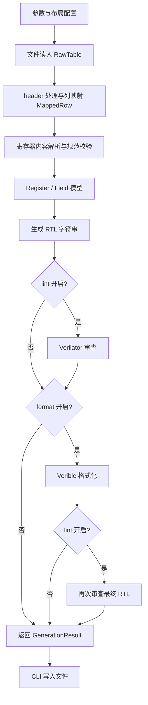

# csrgen 设计文档

文档版本：0.1.15；日期：2026-10-13。

本文描述当前实现的数据结构、模块边界、处理规则及扩展方式。0.1.15 在 0.1.14 的分层实现上补充设计文档，生成接口和 RTL 行为保持一致。模块导航见 [分层架构](ARCHITECTURE.md)，版本演进见 [Release Notes](../RELEASE_NOTES.md)。

## 1. 目标与范围

将表格中的地址和字段定义转换为可综合的 SystemVerilog APB3 寄存器模块。文件格式、表格布局、寄存器规范与 RTL 生成各自独立，使新增文件读入方式时可以复用同一套校验和生成规则。

当前功能约束：

- 内置读入为 XLSX，使用 openpyxl；默认 sheet1，允许选择 sheet。
- APB3 接口，无 PSTRB，数据宽度固定 32 bit；RTL 参数为 `AW`，默认 16。
- 支持 `rw`、外部输入 `ro`、硬件置位/软件写一清零 `rw1c`、写入后下一周期清零 `rwsc`。
- 每个地址完整覆盖 32 bit，reserved 及未定义位始终读零。
- `prdata` 为时钟寄存器输出，读 SETUP 采样、ACCESS 保持；空闲、写操作和未命中读保持原值。
- 所有端口和内部信号使用 `logic`；不输出 description，不插入 synthesis translate 指令或 initial 参数检查段。
- 代码审查和格式化可选，普通生成只需 Python 3.10+ 与 openpyxl。

CSV 尚未作为内置格式开放；文本编码、分隔符等由后续文件适配器处理。当前不提供 GUI、自动 header 猜测或其他总线后端。

## 2. 模块与依赖

| 模块 | 职责 | 主要接口 |
| --- | --- | --- |
| `reader.py` | 格式分派、sheet 选择、原始值读取、文件关闭 | `read_table()`、`read_xlsx_table()` |
| `layout.py` | 跳过 header、列映射、布局合法性检查 | `TableLayout`、`map_rows()` |
| `parser.py` | 将映射后的行解释为字段和地址块 | `parse_registers()` |
| `values.py` | 整数/十六进制转换、空值识别、数字单元格警告 | `_integer()`、`_hex_cell()` |
| `validation.py` | 地址、字段、名称及 reserved 规则 | `validate_registers()` |
| `models.py` | 与文件格式和 RTL 后端无关的数据模型 | `Field`、`Register` |
| `rtl.py` | 从寄存器模型生成 APB3 代码 | `generate_rtl()` |
| `quality.py` | 调用 Verilator 检查生成代码 | `review_rtl()` |
| `formatter.py` | 调用 Verible 格式化代码 | `format_rtl()` |
| `tooling.py` | 工具查找、临时目录、超时和输出捕获 | `run_rtl_tool()`、`ToolReport` |
| `diagnostics.py` | 各阶段共享异常及警告 | `TableError`、`CodeToolError`、两类 Warning |
| `pipeline.py` | 配置及完整处理顺序 | `GenerationOptions`、`run_pipeline()` |
| `cli.py` | 参数、模板、文件名、告警和输出文件 | `main()`、`write_template()` |
| `generator.py` | 保留旧导入路径 | 重导出 `read_xlsx()`、`generate_rtl()` 等 |

文件读入层不解释访问属性，布局层不把单元格转换为寄存器值，RTL 层不打开表格文件。模型和诊断类型是共享接口，外部工具层不参与地址继承或 reserved 处理。

## 3. 数据结构

| 类型 | 内容 | 约束 |
| --- | --- | --- |
| `ReadOptions` | `sheet`、`encoding` | 默认 sheet1/utf-8；XLSX 不使用 encoding |
| `RawRow` | 原始行号 `number`、单元格元组 `cells` | 从 1 开始，保留数字与文本的类型区别 |
| `RawTable` | 路径、原始行元组、实际 sheet 名 | 文件已经关闭，数据可继续处理 |
| `TableLayout` | `header_rows`、字段到物理列号的映射 | 列号从 1 开始；映射经过校验并以只读形式保存 |
| `MappedRow` | 原始行号、按标准字段名组织的值 | 标准键为 offset/signal/reset/bit/access/description |
| `Field` | name、msb、lsb、reset、access、description、row | 字段自身的 reset；width/bits/reserved 由属性计算 |
| `Register` | offset、fields | 一个字节地址对应一个 32-bit 寄存器 |
| `GenerationResult` | 寄存器列表、最终 RTL、审查报告元组 | 不自行写文件 |
| `ToolReport` | 实际命令、stdout、stderr | 仅工具成功时返回；临时文件在执行后删除 |

`Field` 为不可变数据记录，`Register.fields` 为字段列表。description 保留为模型元数据，不进入 RTL。读取后的寄存器列表按 offset 升序排列，字段源行号用于诊断。

当前读入和布局结果都放入内存，便于文件关闭后进行独立处理。若后续支持大表流式读取，需要同时设计适配器的文件生命周期，不能返回依赖已关闭 workbook 的迭代器。

## 4. 配置与执行顺序

`GenerationOptions` 包含：

| 配置 | 默认值 | 用途 |
| --- | --- | --- |
| `read` | `ReadOptions()` | sheet 和适配器编码配置 |
| `layout` | `TableLayout()` | header 与列位置 |
| `module` | `apb_csr` | RTL 模块名 |
| `aw` | 16 | 生成 RTL 的 AW 默认值及地址范围校验 |
| `lint` | False | 开启 Verilator 审查 |
| `format` | False | 开启 Verible 格式化 |
| `lint_tool` | `verilator` | 工具名称或路径 |
| `format_tool` | `verible-verilog-format` | 工具名称或路径 |

完整流程如下：



内容校验始终执行。`generate_rtl()` 作为独立 API 时也校验传入模型，避免调用者绕过表格解析后生成无效代码。`run_pipeline()` 不写文件，CLI 等全部阶段成功后才写入结果。

## 5. 文件和表格格式

### 5.1 XLSX 读入

`read_table()` 根据扩展名选择适配器，内置注册 `.xlsx`，匹配扩展名时忽略大小写。`read_xlsx()` 兼容接口直接调用 XLSX 适配器。

workbook 使用只读模式、`data_only=False`，保留单元格原始值，不求值 Excel 公式。sheet 名先精确匹配；没有精确匹配时忽略大小写查找，未找到或不唯一时报错。原始行读完后在 finally 中关闭 workbook。

### 5.2 Header 与列映射

默认跳过一行，B:G 依次映射到 offset、signal、reset、bit、access、description。header 文字不参与字段定位，不自动判断第一行是否是 header。

- `--header-rows 0`：第一行直接作为数据。
- `--header-rows 2`：跳过标题和 header 两行。
- `--column offset=A` 或 `--column offset=1`：指定列位置。
- `--column description=none`：忽略可选说明列。

必需的五个字段必须映射到不同的正整数列；description 可为 None。未知字段、无效列号、重复指定同一字段或多个字段共用一列均报错。映射列超出某行已有单元格数量时，该值视为 None，并由内容层按缺失规则处理。

未映射的列不参与解析。跳过 header、重排列或忽略空行不会改变原始行号。

## 6. 寄存器解析和规范校验

### 6.1 地址块

非空 offset 开始或延续一个地址块；空 offset 沿用前一个地址。全空映射行忽略，单独的地址行可为后续字段指定地址，但不生成无字段寄存器。

同一个块的连续字段行可以重复填写相同 offset。若已经切换到另一个 offset 后又返回先前地址，则报重复地址错误，并给出两处行号。通过 Python 直接传入模型时，重复的 `Register.offset` 也会被拒绝。

offset 是非负字节地址，必须 4 字节对齐，且 `offset + 3 < 2**aw`。生成阶段 aw 支持 2～32；实例化时覆盖 AW 仍须容纳全部地址，RTL 不额外加入运行时参数检查。

### 6.2 值和字段

| 项目 | 规则 |
| --- | --- |
| offset/reset 文本 | 十六进制，可带 0x 或下划线 |
| offset/reset 数字单元格 | 按数值使用；不小于 10 时警告两种读法的差异 |
| bit | 支持单 bit、msb:lsb 及带方括号形式 |
| 位段 | 必须满足 0 ≤ lsb ≤ msb ≤ 31，任意字段之间不得重叠 |
| reset | 字段自身的非负值，必须小于 `2**width`，不是移位后的寄存器值 |
| access | 忽略大小写，允许 rw/ro/rw1c/rwsc |
| signal | 合法 SystemVerilog 标识符，全模块唯一，不能与关键字或生成名称冲突 |
| 非整数、布尔数值、公式 | 不作为有效寄存器值接受 |

名称校验包含 APB 端口、内部控制信号、`OFFSET_0x*`、`csr_reg_data_0x*` 和 W1C 的 `<signal>_hwset`。首个字段没有 offset、必需内容缺失、地址/位段/reset/属性错误均报错。

### 6.3 Reserved

名为 reserved 的字段忽略大小写，可在同一或不同地址重复出现。每段仍参与位段范围和重叠检查，但不参与普通信号的重名检查，也不生成端口或状态寄存器。

reserved 的 reset/access 强制为 0/ro。表格不一致、缺失或无法解析时发出 `ReservedFieldWarning` 并继续；越界或重叠仍报错。明确的 reserved 和所有未定义位都按连续区间补零，相邻区间会合并。

## 7. RTL 设计

### 7.1 接口与命名

APB 端口为 pclk、presetn、psel、penable、pwrite、paddr、pwdata、prdata、pready、pslverr。presetn 为异步低有效复位，数据端口固定 32 bit，paddr 为 `[AW-1:0]`。

默认模块/文件为 `apb_csr`/`apb_csr.sv`。`--module-prefix` 与 `--file-prefix` 独立；完整名称通过 `--module`、`--output` 指定。

地址 0x1C 对应 `OFFSET_0x1c` 和 `csr_reg_data_0x1c`。每个地址的读值信号集中声明，末尾附 offset 注释；拼接按 bit 31 到 bit 0，每行一个字段并标注 bit/reset/access。所有信号为 logic，可写字段和 prdata 由 always_ff 直接驱动，不引入额外的 *_q 连接。

### 7.2 APB 时序

```systemverilog
assign pready    = 1'b1;
assign pslverr   = psel && penable && !csr_addr_hit;
assign csr_write = psel && penable && pwrite && pready && !pslverr;
assign csr_read  = psel && !penable && !pwrite && csr_addr_hit;
```

| 情况 | prdata | 字段状态 / 错误响应 |
| --- | --- | --- |
| 复位有效 | 异步清零 | 可写字段复位为表中值 |
| 有效读 SETUP 结束的上升沿 | 锁存当前组合读值 | RO 输入在此时采样 |
| 读 ACCESS | 保持 SETUP 快照 | PREADY=1，无额外等待 |
| 有效写 ACCESS 结束的上升沿 | 保持 | 更新可写字段，RO/reserved 不写 |
| 空闲或未选中 | 保持 | RW 不变；硬件置位及 RWSC 自动清零规则仍有效 |
| 未映射或非对齐地址 | 保持 | ACCESS 阶段 PSLVERR=1，不执行软件写入 |

读值先组合选择到 csr_data，再在 SETUP 结束的上升沿锁存。外部 RO 在 ACCESS 改变，不影响已采样响应。同一沿的字段非阻塞更新发生在采样之后，因此采样得到更新前的字段值。

### 7.3 访问属性

| 属性 | 端口 | 状态更新 |
| --- | --- | --- |
| rw | 输出字段 | 有效写取 pwdata 对应位段，其余保持 |
| ro | 输入字段 | 无内部存储；软件写忽略，外部负责状态及复位 |
| rw1c | 输出字段、同宽 hwset 输入 | 软件写一清对应位，写零无动作；硬件置位优先 |
| rwsc | 输出字段 | 有效写取 pwdata 位段；下一次没有新有效写入的上升沿清零 |

W1C 对每个 bit 独立计算：有效写时 `(field & ~write_bits) | hwset`，其他周期 `field | hwset`。hwset 为同步电平输入，持续为 1 会持续置位。

RWSC 支持单 bit、多 bit 和完整 32 bit。新有效写入优先于自动清零，写零不产生置位脉冲，复位值来自表格；复位释放后没有有效写入的下一上升沿也会清零。读 SETUP 与清零同沿时，prdata 可以锁存清零前的值，并在 ACCESS 保持。

RO 的 reset 值作为表格元数据和拼接注释保留，不对外部输入执行复位。reserved 的注释和实际读值均固定为 0/ro。

## 8. 代码审查、格式化与诊断

Verilator 通过 `--lint-only --top-module <module>` 检查 RTL。Verible 使用 `--failsafe_success=false`，语法错误不能以成功状态返回。工具由 PATH 或显式路径查找，在各自临时目录中以参数列表运行，源文件写为 UTF-8，stdout/stderr 被捕获；默认超时为 60 秒。

工具不存在、执行失败、超时或格式化输出为空时抛出 `CodeToolError`。失败诊断包含工具名，非零退出优先提供 stderr。成功的 Verilator 报告保存在 `GenerationResult.reviews`：不开 lint 为 0 次，仅 lint 为 1 次，lint+format 为 2 次。

| 诊断 | 含义 | CLI 行为 |
| --- | --- | --- |
| TableError | 布局或寄存器规范不合法 | 报错，退出 2 |
| ReservedFieldWarning | reserved 元数据被覆盖 | 警告，继续生成 |
| NumericCellWarning | 十六进制列使用数字单元格 | 警告，继续按原数值生成 |
| CodeToolError | 审查或格式化工具未完成 | 报错，退出 2 |
| 文件/工作簿异常 | 打开、读取或写入失败 | 报错，退出 2 |

CLI 在完整流程成功前不会写输出，所以内容校验或工具失败不会覆盖已有输出。最终写文件仍使用普通 UTF-8 文件写入，不承诺操作系统写入错误时的事务回滚。

lint 检查不能代替行为仿真，也不自动证明时钟域同步、时序收敛或系统集成正确性。实现目前不记录外部工具版本，发布验证应记录实际使用的工具和结果。

## 9. 扩展与兼容

新增读入格式需要实现 `adapter(path, ReadOptions) -> RawTable`，并通过 `run_pipeline(..., readers={".csv": adapter})` 注册。适配器自行处理编码、分隔符和引号，保留行号与单元格类型，在返回前关闭文件。布局和寄存器解析无需识别文件来源。

新增布局规则应放在 layout 层，保持默认 B:G 和 header_rows=1。若未来引入 header 名称识别，应使用明确的独立模式，不能改变当前按位置读取的默认行为。

新增总线后端应消费 Register/Field，复用内容校验。新增访问属性则需要同步解析允许值、名称冲突规则、端口生成、状态更新和行为测试。

兼容入口 `from csrgen import read_xlsx, generate_rtl` 与 `from csrgen.generator import ...` 保留。`read_xlsx(..., layout=...)` 扩展为可选关键字配置；命令行仍用 `--aw`，生成 RTL 用 AW。

## 10. 验证与发布

当前测试包括原有 70 项行为/解析/CLI 回归与 22 项分层流程测试，共 92 项。外部工具未安装时，相关集成测试会跳过；普通读表与生成测试仍执行。

- 默认生成结果与 examples/apb_csr.sv 逐字比较。
- 检查无 header、多行 header、列重排、远端列、无效映射和实际源行号。
- 验证自定义 CSV 适配器可消费指定编码并复用模型解析；不将其视为内置 CSV 支持。
- 验证缺少工具、语法错误和错误格式化输出会报错，并保留已有输出。
- 使用真实 Verilator/Verible 检查格式化前后的结果。
- 使用 APB、reserved、rwsc 行为仿真检查寄存器语义；0.1.14 的格式化后 RTL 已通过 APB 行为仿真。

发布使用 Python 3.12 执行 `uv build --python 3.12`，先生成 sdist，再从 sdist 构建 wheel。源码包通过 MANIFEST.in 包含源码、启动脚本、示例、设计/架构文档、release note 和测试；wheel 包含安装后的 Python 模块与 CLI 入口。

发布检查包括 wheel 文件完整性、包内源码与工作区一致、sdist 文档与示例齐全、安装环境中的版本号和模块来源、默认 RTL 一致以及带审查/格式化的 CLI 流程。历史构建产物保留，版本升级后使用新文件名。
