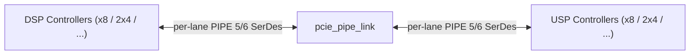
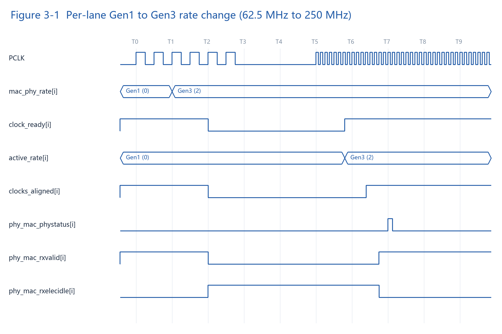
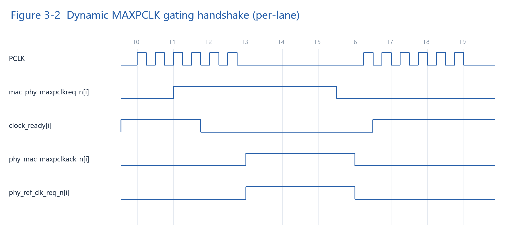
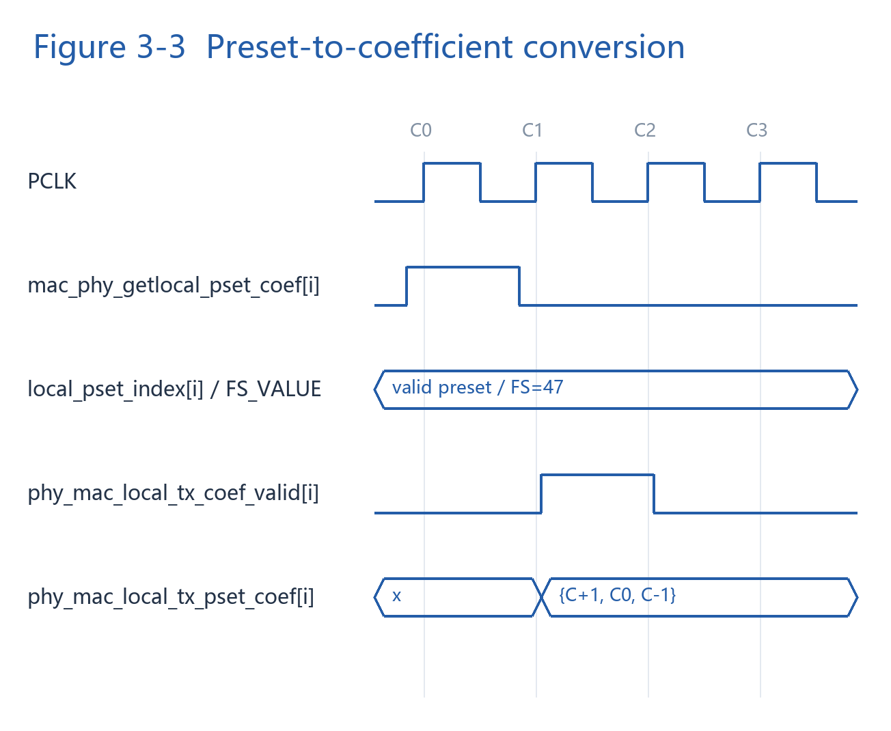
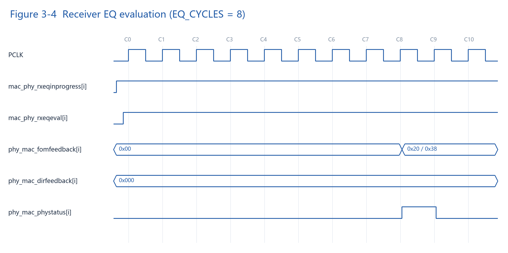

# pcie_pipe_link

## 1. Overview

### 1.1 Module Summary

`pcie_pipe_link` connects the PIPE interfaces of two PCIe controllers at the SerDes PIPE boundary (`Gen1` through `Gen6`), transports data across independent per-lane asynchronous clock domains, and provides simplified PHY clocking, status, equalization, and PIPE MessageBus responses.

- `dsp_*` connects to Downstream Port (DSP) controller lanes (for example, Root Port or Switch Downstream Port).
- `usp_*` connects to Upstream Port (USP) controller lanes (for example, Endpoint or Switch Upstream Port).

Main features:

- **PCIe 6.0 SerDes Architecture (`MAX_RATE=5`)**: Supports Gen1 (`62.5 MHz`) through Gen6 (`1000 MHz x 8s`) operation with parameterized SerDes data and electrical-idle widths (`DATA_WD=80`, `TXEI_WD=4`, `DIRFEEDBACK_WD=12` by default; parameterizable down to Gen5 SerDes such as `DATA_WD=40`, `DIRFEEDBACK_WD=6`, `MAX_RATE=4`).
- **Full Per-Lane Bifurcation**: Every reset, clock, rate, powerdown, EQ, MessageBus, and SerDes data port is defined independently per lane (`[NL-1:0]` / `[NL*W-1:0]`). A single `pcie_pipe_link` instance (for example `NL=8`) supports `x8`, `2x4`, `x4+2x2`, or arbitrary per-lane sub-link combinations.
- **Glitch-Free `always_latch + and` Clock Gating**: `pcie_pipe_clock_gate` uses a 2-FF `request` synchronizer in the target clock domain, a negative-level `always_latch` (`RESET_ENABLE` configurable), and a combinational `clk & gate_enable` AND gate.
- **`pclk_as_phy_input` Dynamic MAXPCLK & Recovered RX Clock**: Outputs per-lane `max_pclk[i]` and peer-rate-tracked `rx_clk[i]`, accepts MAC-supplied `pclk[i]`, and handshakes `mac_phy_maxpclkreq_n[i]` / `phy_mac_maxpclkack_n[i]`.
- **Race-Free Async CDC FIFO**: Each direction of each lane crosses `tx_pclk -> rx_clk` through an asynchronous Gray-code FIFO (`pcie_pipe_cdc_fifo`, `FIFO_DEPTH=8` default).
- **PIPE 5.1/6.0 MessageBus & Equalization Bypass**: `pcie_pipe_msgbus_lane` initializes LocalFS/LocalLF registers on startup, handles MAC register reads/writes, and bridges EQ preset/evaluation events. `pcie_pipe_lane` also supports 2-FF synchronized `rxpolarity` bitwise inversion.
- **Unmodeled Analog Features**: TxMargin, TxSwing, TxDeemph channel effects, RX preset hints, and physical error injection are not modeled; analog FS/LF values use constant parameter defaults (`FS_VALUE=47`, `LF_VALUE=15`).



*Figure 1-1. Example multi-controller / bifurcated SerDes PIPE connection*

### 1.2 Internal Architecture

`pcie_pipe_link` instantiates two symmetric per-side wrappers (`u_dsp_side` and `u_usp_side` of `pcie_pipe_side`) plus `NL` bidirectional datapath instances (`u_lane` of `pcie_pipe_lane`):

- `pcie_pipe_pclk_switch`: Two instances per lane on each side (`u_max_pclk_switch` controlled by `!mac_phy_maxpclkreq_n[i]` and `u_rx_clk_switch` always enabled and tracking `peer_active_rate[i]`), built from five `pcie_pipe_clock_gate` cells (`62.5`, `125`, `250`, `500`, `1000 MHz`).
- `pcie_pipe_status_lane`: Per-lane `pclk[i]`-domain handler for reset completion, rate-change completion, powerdown transitions, `txdetectrx_loopback` in `P1`, and `rxstandbystatus`.
- `pcie_pipe_eq_lane`: Per-lane preset-to-coefficient converter and `EQ_CYCLES` evaluation timer.
- `pcie_pipe_msgbus_lane`: Per-lane PIPE 5.1/6.0 8-bit MessageBus receiver, register file, boot-time FS/LF initializer, and 16-entry transmit command queue.
- `pcie_pipe_lane`: Per-lane bidirectional datapath containing two `pcie_pipe_cdc_fifo` instances (`DSP TX -> USP RX` and `USP TX -> DSP RX`) plus synchronized electrical-idle gating and `rxpolarity` inversion.

## 2. Interface Description

### 2.1 I/O List

All directions are relative to `pcie_pipe_link`. `NL` is the number of lanes per side. The `side_` prefix represents two separate sets of ports, with `dsp_` and `usp_` prefixes (for example, `side_mac_phy_rate` represents `dsp_mac_phy_rate` and `usp_mac_phy_rate`).

| Type | Definition |
| :--- | :--- |
| Common | Input shared by both the DSP and USP sides |
| Per-lane | Independent slice for each lane on a side, packed little-endian (`lane i` at `[i*W +: W]` or `[i]`) |

All DSP and USP control, clock, reset, power, EQ, MessageBus, and datapath ports are **Per-lane**, enabling independent link widths and bifurcation per sub-link.

#### 2.1.1 Parameters

| Parameter | Default | Description |
| :--- | ---: | :--- |
| `NL` | 4 | Number of lanes per side; must be greater than 0 |
| `DATA_WD` | 80 | SerDes `txdata`/`rxdata` width per lane (for example `80` for Gen6 8s or `40` for Gen5 SerDes) |
| `TXEI_WD` | 4 | `txelecidle` bit width per lane; lane TX idle occurs when `&txelecidle` is 1 |
| `DIRFEEDBACK_WD` | 12 | Direction feedback bus width per lane |
| `FOMFEEDBACK_WD` | 8 | Figure-of-Merit feedback width per lane |
| `TX_COEF_WD` | 18 | Packed TX coefficient width `{C+1[5:0], C0[5:0], C-1[5:0]}` per lane |
| `TX_PSET_WD` | 6 | Local TX preset index width per lane |
| `FS_LF_WD` | 6 | Full-swing (`FS`) and low-frequency (`LF`) bus width per lane |
| `RX_PSET_WD` | 3 | Receiver preset hint width per lane |
| `PCLK_RATE_WD` | 5 | `mac_phy_pclk_rate` port width per lane (reserved input) |
| `MAX_RATE` | 3'd5 | Maximum supported `mac_phy_rate` code (`4` for Gen5, `5` for Gen6) |
| `ACK_CYCLES` | 8 | Completion wait count in local `pclk` cycles for rate, powerdown, and TxDetectRx responses; must be at least 1 |
| `EQ_CYCLES` | 8 | Equalization evaluation delay per lane in local `pclk` cycles; must be at least 1 |
| `FIFO_DEPTH` | 8 | Async Gray CDC FIFO depth per direction per lane (power of 2) |

#### 2.1.2 Common Clock Inputs and Alignment Status

| Port | Direction | Width | Type | Description |
| :--- | :--- | ---: | :--- | :--- |
| `pclk_62p5` | Input | 1 | Common | 62.5 MHz Gen1 reference source |
| `pclk_125` | Input | 1 | Common | 125 MHz Gen2 reference source |
| `pclk_250` | Input | 1 | Common | 250 MHz Gen3 reference source |
| `pclk_500` | Input | 1 | Common | 500 MHz Gen4 reference source |
| `pclk_1000` | Input | 1 | Common | 1000 MHz Gen5/Gen6 source and switch-FSM clock |
| `clocks_aligned` | Output | `NL` | Per-lane | Asserted per lane `i` when both sides have `phy_rst_n[i]=1`, `clock_ready[i]=1`, and `dsp_active_rate[i]==usp_active_rate[i]` |

All five `pclk_*` inputs must run continuously during reset, rate changes, and low-power states. `pclk_1000` additionally clocks every `pcie_pipe_pclk_switch` state machine.

#### 2.1.3 Per-Lane Clock, Reset, and Power Interfaces

| Port | Direction | Width per side | Type | Description |
| :--- | :--- | ---: | :--- | :--- |
| `side_phy_rst_n` | Input | `NL` | Per-lane | Local active-low asynchronous reset for lane `i` |
| `side_pclk` | Input | `NL` | Per-lane | Local MAC PCLK returned to PHY (`pclk_as_phy_input` mode), clocking lane `i` TX FIFO write, status, EQ, and MessageBus logic |
| `side_mac_phy_maxpclkreq_n` | Input | `NL` | Per-lane | Active-low MAC clock request; `1` requests gating `side_max_pclk[i]` |
| `side_max_pclk` | Output | `NL` | Per-lane | Switched/gated PCLK output to local MAC logic for lane `i` |
| `side_rx_clk` | Output | `NL` | Per-lane | Recovered RX clock tracking `peer_active_rate[i]` (or local `mac_phy_rate[i]` while peer is in reset) |
| `side_phy_mac_maxpclkack_n` | Output | `NL` | Per-lane | Active-high acknowledgement indicating `side_max_pclk[i]` is gated (`ST_GATED`) |
| `side_phy_ref_clk_req_n` | Output | `NL` | Per-lane | Tracks `ST_GATED` (`1` when MAXPCLK is gated off, `0` when active) |
| `side_active_rate` | Output | `NL*3` | Per-lane | Active rate code (`0..MAX_RATE`) after clock switching completes |
| `side_clock_ready` | Output | `NL` | Per-lane | High when lane `i` switch is in `ST_RUN`, `clk_en=1`, valid `rate_req==active_rate`, and selected `gate_enable` is active |
| `side_mac_phy_rate` | Input | `NL*3` | Per-lane | Requested PCIe rate code (`0`=Gen1 through `5`=Gen6) |
| `side_mac_phy_powerdown` | Input | `NL*4` | Per-lane | Power-state request; TX/RX forwarding is enabled only when `powerdown == 4'd0` (`P0`) |
| `side_mac_phy_asyncpowerchangeack` | Input | `NL` | Per-lane | Present for PIPE port compatibility; sampled as unused in synchronous `pclk` status logic |

#### 2.1.4 Per-Lane SerDes Data and Lane-Control Interfaces

| Port | Direction | Width per side | Type | Description |
| :--- | :--- | ---: | :--- | :--- |
| `side_mac_phy_txdata` | Input | `NL*DATA_WD` | Per-lane | Parallel SerDes TX data forwarded through `pcie_pipe_cdc_fifo` to peer `rxdata` |
| `side_mac_phy_txelecidle` | Input | `NL*TXEI_WD` | Per-lane | Per-symbol/lane TX electrical idle; TX is idle when `&txelecidle` is 1 |
| `side_mac_phy_txdatavalid` | Input | `NL` | Per-lane | TX FIFO write qualification when out of idle and aligned |
| `side_mac_phy_txdetectrx_loopback` | Input | `NL` | Per-lane | Rising edge in `P1` with `&txelecidle==1` triggers receiver detection completion |
| `side_mac_phy_rxstandby` | Input | `NL` | Per-lane | Registered into `side_phy_mac_rxstandbystatus` on `side_pclk` |
| `side_mac_phy_rxpolarity` | Input | `NL` | Per-lane | Synchronized via 2-FF into peer `rx_clk` domain (OR `rx_clk`); bitwise-inverts `rxdata` |
| `side_serdes_pipe_turnoff_lanes` | Input | `NL` | Per-lane | Forces local TX idle toward peer (`wr_en=0`, synchronized `rxelecidle=1`) and keeps local `rxelecidle=1` when FIFO is empty |
| `side_phy_mac_rxdata` | Output | `NL*DATA_WD` | Per-lane | Peer TX data from async CDC FIFO (bitwise inverted when `rxpolarity` synced=1); `0` when empty |
| `side_phy_mac_rxvalid` | Output | `NL` | Per-lane | Asserted (`1`) on `side_rx_clk` whenever `pcie_pipe_cdc_fifo` delivers valid data (`!rd_empty`) |
| `side_phy_mac_rxstatus` | Output | `NL*3` | Per-lane | `3'b011` on `txdetectrx_loopback` completion when `peer_phy_rst_n[i]==1`; otherwise `3'b000` |
| `side_phy_mac_rxelecidle` | Output | `NL` | Per-lane | `0` when FIFO yields valid data; otherwise driven by synchronized peer idle, `powerdown != P0`, or `turnoff_lanes` |
| `side_phy_mac_rxstandbystatus` | Output | `NL` | Per-lane | Registered feedback of local `rxstandby` on `side_pclk` |
| `side_phy_mac_phystatus` | Output | `NL` | Per-lane | `1` during reset, then 1-`pclk`-cycle pulses for control completions and non-MessageBus EQ completions |

#### 2.1.5 Per-Lane EQ and MessageBus Interfaces

| Port | Direction | Width per side | Type | Description |
| :--- | :--- | ---: | :--- | :--- |
| `side_mac_phy_rxeqeval` | Input | `NL` | Per-lane | Rising edge (while `rxeqinprogress=1`) starts `EQ_CYCLES` evaluation; ORed with MessageBus `12'h006[0]` |
| `side_mac_phy_rxeqinprogress` | Input | `NL` | Per-lane | Must remain 1 during EQ evaluation; clearing it aborts evaluation and zeroes feedback; ORed with MessageBus `12'h006[1]` |
| `side_mac_phy_getlocal_pset_coef` | Input | `NL` | Per-lane | Asserts 1-cycle preset-to-coefficient conversion; ORed with MessageBus `12'h405[7]` |
| `side_mac_phy_local_pset_index` | Input | `NL*TX_PSET_WD` | Per-lane | Sideband 6-bit preset index (`[5:0]` selects PCIe presets `P0..P10`); overridden when MessageBus triggers conversion |
| `side_mac_phy_messagebus` | Input | `NL*8` | Per-lane | 8-bit MAC-to-PHY MessageBus stream decoded by `pcie_pipe_msgbus_lane` |
| `side_phy_mac_localfs` | Output | `NL*FS_LF_WD` | Per-lane | Constant `FS_VALUE` (default `47`) |
| `side_phy_mac_locallf` | Output | `NL*FS_LF_WD` | Per-lane | Constant `LF_VALUE` (default `15`) |
| `side_phy_mac_dirfeedback` | Output | `NL*DIRFEEDBACK_WD` | Per-lane | `0` after reset and on evaluation completion |
| `side_phy_mac_fomfeedback` | Output | `NL*FOMFEEDBACK_WD` | Per-lane | `0` while `!rxeqinprogress`; updates on evaluation completion to `8'h20` (Gen3–Gen5) or `8'h38` (Gen6, `rate>=5`) |
| `side_phy_mac_local_tx_pset_coef` | Output | `NL*TX_COEF_WD` | Per-lane | Registered `{C+1[5:0], C0[5:0], C-1[5:0]}` result for `local_pset_index` |
| `side_phy_mac_local_tx_coef_valid` | Output | `NL` | Per-lane | One-cycle strobe aligned with `local_tx_pset_coef` |
| `side_phy_mac_messagebus` | Output | `NL*8` | Per-lane | 8-bit PHY-to-MAC MessageBus stream driven by `pcie_pipe_msgbus_lane` |

#### 2.1.6 Unused / Compatibility Ports

| Port | Direction | Width per side | Type | Description |
| :--- | :--- | ---: | :--- | :--- |
| `side_mac_phy_pclk_rate` | Input | `NL*PCLK_RATE_WD` | Per-lane | Unused; `side_mac_phy_rate` selects frequency |
| `side_mac_phy_serdes_arch` | Input | `NL` | Per-lane | Unused; SerDes architecture is fixed at elaboration |
| `side_mac_phy_width` | Input | `NL*2` | Per-lane | Unused; width fixed by `DATA_WD` |
| `side_mac_phy_rxwidth` | Input | `NL*2` | Per-lane | Unused; width fixed by `DATA_WD` |
| `side_serdes_pipe_rxready` | Input | `NL` | Per-lane | Unused compatibility input |
| `side_mac_phy_invalid_req` | Input | `NL` | Per-lane | Unused in bypassed EQ evaluation (also mapped in MessageBus `12'h006[2]`) |
| `side_mac_phy_dirchange` | Input | `NL` | Per-lane | Unused in bypassed EQ evaluation |
| `side_mac_phy_txdeemph` | Input | `NL*TX_COEF_WD` | Per-lane | Unused channel parameter (also mapped in MessageBus `12'h402..404`) |
| `side_mac_phy_fs` / `side_mac_phy_lf` | Input | `NL*FS_LF_WD` | Per-lane | Unused analog parameter (also mapped in MessageBus `12'h406..407`) |
| `side_mac_phy_rxpresethint` | Input | `NL*RX_PSET_WD` | Per-lane | Unused compatibility input |
| `side_mac_phy_txmargin` | Input | `NL*3` | Per-lane | Unused compatibility input (stored in MessageBus `12'h408[2:0]`) |
| `side_mac_phy_txswing` | Input | `NL` | Per-lane | Unused compatibility input (stored in MessageBus `12'h408[3]`) |
| `side_mac_phy_pipe_config_control` | Input | `NL*32` | Per-lane | Unused compatibility input |
| `side_phy_mac_pipe_config_status` | Output | `NL*32` | Per-lane | Constant `0` |

## 3. Functional Behavior and Timing

### 3.1 Rate Change, Clock Gating, Reset, and Data Transfer

#### 3.1.1 Rate Change and Frequency Table

| `mac_phy_rate[i]` | PCIe Rate | Source Clock | Frequency |
| ---: | :--- | :--- | ---: |
| 0 | Gen1, 2.5 GT/s | `pclk_62p5` | 62.5 MHz |
| 1 | Gen2, 5.0 GT/s | `pclk_125` | 125 MHz |
| 2 | Gen3, 8.0 GT/s | `pclk_250` | 250 MHz |
| 3 | Gen4, 16.0 GT/s | `pclk_500` | 500 MHz |
| 4 | Gen5, 32.0 GT/s | `pclk_1000` | 1000 MHz |
| 5 | Gen6, 64.0 GT/s (`x8s`) | `pclk_1000` | 1000 MHz |

Each lane on each side switches independently using `pcie_pipe_pclk_switch`:

1. `rate_req` (`mac_phy_rate[i]`) is double-synchronized into `pclk_1000`. A request is accepted when `rate_meta == rate_sync <= MAX_RATE`.
2. **Same source clock (`Gen5 <-> Gen6`)**: Both rate `4` and `5` use `pclk_1000`, so `active_rate[i]` updates directly in `ST_RUN` without gating or stopping `max_pclk[i]`.
3. **Different source clock**: `ST_RUN -> ST_WAIT_OFF` deasserts all `gate_request` bits. Once `gate_enable` synchronizes back as `5'b00000`, `ST_WAIT_ON` asserts the single target bit in `gate_request`. After `enable_sync == gate_request`, `active_rate[i]` updates and `clock_ready[i]` re-asserts.
4. Once `clock_ready[i] && (active_rate[i] == mac_phy_rate[i])`, `pcie_pipe_status_lane` waits `ACK_CYCLES` on local `pclk[i]` and emits a 1-cycle `phy_mac_phystatus[i]` pulse.



*Figure 3-1. Per-lane Gen1-to-Gen3 rate-change timing*

#### 3.1.2 `always_latch + and` Clock Gating and Dynamic MAXPCLK

Every source clock branch in `pcie_pipe_pclk_switch` passes through `pcie_pipe_clock_gate`:

```text
request --(2-FF @ posedge clk)--> request_sync --(always_latch @ !clk)--> gate_enable
gclk = clk & gate_enable
```

During reset (`phy_rst_n=0`), `u_gate_62p5` initializes with `RESET_ENABLE=1'b1` and all higher gates initialize with `RESET_ENABLE=1'b0`, providing an immediate glitch-free 62.5 MHz clock while resetting.

Dynamic MAXPCLK gating operates per lane via `mac_phy_maxpclkreq_n[i]`:

1. Asserting `mac_phy_maxpclkreq_n[i]=1` (`clk_en=0`) moves `u_max_pclk_switch` from `ST_RUN` to `ST_WAIT_GATE_OFF`, clearing `gate_request`.
2. `clock_ready[i]` drops, the active `pcie_pipe_clock_gate` closes cleanly on the low phase of `clk`, and `max_pclk[i]` stops low without runt pulses.
3. Once `enable_sync == 5'b00000`, the switch enters `ST_GATED` and asserts `phy_mac_maxpclkack_n[i]=1` and `phy_ref_clk_req_n[i]=1`.
4. Returning `mac_phy_maxpclkreq_n[i]=0` restarts the selected target clock (`ST_GATED -> ST_WAIT_ON -> ST_RUN`) and deasserts `maxpclkack_n[i]` and `phy_ref_clk_req_n[i]`.



*Figure 3-2. Per-lane Dynamic MAXPCLK gating handshake*

#### 3.1.3 Reset and Per-Lane Bifurcation

`dsp_phy_rst_n[i]` and `usp_phy_rst_n[i]` reset lane `i` independently. While `phy_rst_n[i]==0`, `phy_mac_phystatus[i]` is held at `1`, `active_rate[i]` resets to `0`, `max_pclk[i]` selects `pclk_62p5`, and `clocks_aligned[i]` is `0`. On reset release, the first `pclk[i]` edge clears `phystatus`.

Because `u_max_pclk_switch`, `u_rx_clk_switch`, `u_status_lane`, `u_eq_lane`, `u_msgbus_lane`, and `u_lane` are all instantiated strictly inside `for (genvar i = 0; i < NL; i++)`, sub-links with different controller instances (for example, `NL=8` wired as `x4 + x2 + x2`, or two `x4` controllers on DSP linked to USP) operate at completely independent rates, resets, and power states without cross-lane interference.

#### 3.1.4 Bidirectional SerDes CDC Datapath

Each direction in `pcie_pipe_lane` wraps a `pcie_pipe_cdc_fifo #(.WIDTH(DATA_WD), .DEPTH(FIFO_DEPTH))`:

- **Write domain (`side_pclk[i]`)**: Writes `txdata` when `fifo_rst_n && !tx_idle && txdatavalid`, where `tx_idle = (&txelecidle) || (powerdown != 4'd0) || turnoff_lane`, and `fifo_rst_n = dsp_phy_rst_n[i] && usp_phy_rst_n[i] && clocks_aligned[i]`.
- **Read domain (`peer_rx_clk[i]`)**: Automatically pops whenever `!rd_empty`. While data is available, `rxvalid=1`, `rxelecidle=0`, and `rxdata = pol_sync ? ~fifo_rdata : fifo_rdata`. When empty, `rxdata=0`, `rxvalid=0`, and `rxelecidle` tracks synchronized peer `tx_idle`, local `powerdown != P0`, or local `turnoff_lane`.
- `rx_clk[i]` follows `peer_active_rate[i]` whenever `peer_phy_rst_n[i]==1`, ensuring CDC read timing matches peer symbol rate even across asymmetric intermediate states until `clocks_aligned[i]` goes high.

### 3.2 Control Completions (`pcie_pipe_status_lane`)

In `pcie_pipe_status_lane` (clocked by `side_pclk[i]`):

| Event | Trigger | Latency | Output Response |
| :--- | :--- | :--- | :--- |
| Rate change | `rate != prev_rate` | `ACK_CYCLES` cycles after `clock_ready && active_rate==rate` | 1-cycle `phy_mac_phystatus[i]=1` |
| Powerdown change | `powerdown != prev_powerdown` | `ACK_CYCLES` local `pclk[i]` cycles | 1-cycle `phy_mac_phystatus[i]=1` |
| Receiver detection | Rising `txdetectrx_loopback` in `P1` (`4'd2`) with `&txelecidle==1` | `ACK_CYCLES` local `pclk[i]` cycles | 1-cycle `phy_mac_phystatus[i]=1` and `rxstatus = peer_phy_rst_n[i] ? 3'b011 : 3'b000` |

### 3.3 Equalization Bypass and PIPE 5.1/6.0 MessageBus

#### 3.3.1 Preset-to-Coefficient Conversion Timing

When `getlocal_pset_coef` is sampled high on `side_pclk[i]` (either directly via `side_mac_phy_getlocal_pset_coef[i]` or committed via MessageBus `12'h405[7]`), `pcie_pipe_eq_lane` computes standard PCIe Gen3–Gen6 `{C+1[5:0], C0[5:0], C-1[5:0]}` from `local_pset_index` using `FS_VALUE=47`, and registers `local_tx_pset_coef` and a 1-cycle `local_tx_coef_valid=1` on the next `pclk[i]` cycle (no `phystatus` pulse).



*Figure 3-3. Preset-to-coefficient conversion timing*

#### 3.3.2 Receiver Equalization Evaluation Timing

While `rxeqinprogress=1`, a rising edge on `rxeqeval` starts an `EQ_CYCLES` timer in `pcie_pipe_eq_lane` (using `EQ_CYCLES=8` in the example). Upon completion at `C8`, `dirfeedback` drives `0`, `fomfeedback` updates to `8'h20` (Gen3–Gen5) or `8'h38` (Gen6, `rate>=5`), and `phystatus_eq` pulses for 1 cycle. Dropping `rxeqinprogress` resets `eval_busy`, `dirfeedback`, and `fomfeedback` to `0`. If evaluation was triggered over MessageBus (`msg_eq_active=1`), `phystatus_eq` is suppressed and feedback is delivered via MessageBus registers `12'h00A` and `12'h00B` instead.



*Figure 3-4. Receiver equalization evaluation timing*

#### 3.3.3 PIPE 5.1/6.0 MessageBus (`pcie_pipe_msgbus_lane`)

`pcie_pipe_msgbus_lane` implements bidirectional 8-bit MessageBus framing (`CMD_NOP=0`, `CMD_WR_UC=1`, `CMD_WR_C=2`, `CMD_RD=3`, `CMD_RD_CPL=4`, `CMD_WR_ACK=5`) on `side_pclk[i]`:

- **Boot-time FS/LF announcement**: Nine `pclk` cycles after `clock_ready[i]` stabilizes, pushes `WR_UC/WR_C` register pairs initializing `{12'h403, 12'h404}`, `{12'h405, 12'h406}`, and `{12'h00C, 12'h00D}` with `localfs`/`locallf`.
- **MAC-to-PHY decoded registers**: Uncommitted writes (`WR_UC`) stage fields and committed writes (`WR_C`) atomically latch them and return `CMD_WR_ACK`; reads (`RD`) return `CMD_RD_CPL`:

| Address | Bits / Field |
| :--- | :--- |
| `12'h003` | `[0]` `msg_rxpolarity` |
| `12'h006` | `[2]` `msg_invalid_req`, `[1]` `msg_rxeqinprogress`, `[0]` `msg_rxeqeval` (writing sets `msg_eq_active`) |
| `12'h402..404` | `[5:0]` chunks of `msg_txdeemph[17:0]` |
| `12'h405` | `[7]` `msg_getlocal_pset_coef` pulse, `[5:0]` `msg_local_pset_index` |
| `12'h406` / `407` | `[5:0]` `msg_fs` / `[5:0]` `msg_lf` |
| `12'h408` | `[3]` `msg_txswing`, `[2:0]` `msg_txmargin` |

- **PHY-to-MAC event transmit queue (16 entries)**:
  - On `eq_local_tx_coef_valid`: pushes `WR_UC 12'h400 (coef[5:0])`, `WR_UC 12'h401 (coef[11:6])`, `WR_C 12'h402 (coef[17:12])`.
  - On `eq_eval_done && msg_eq_active`: pushes `WR_UC 12'h00A` (`fom[7:0]` for Gen6, `{2'b00, fom[5:0]}` otherwise), `WR_C 12'h00B (dirfeedback[5:0])`.
