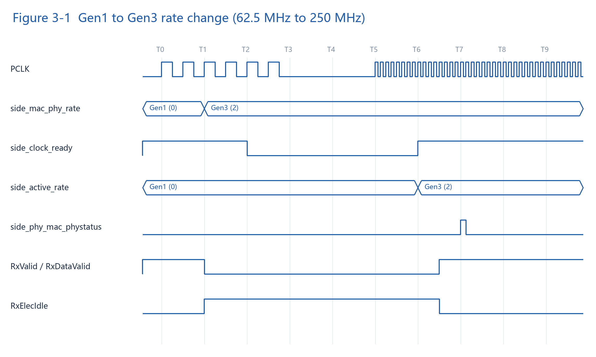
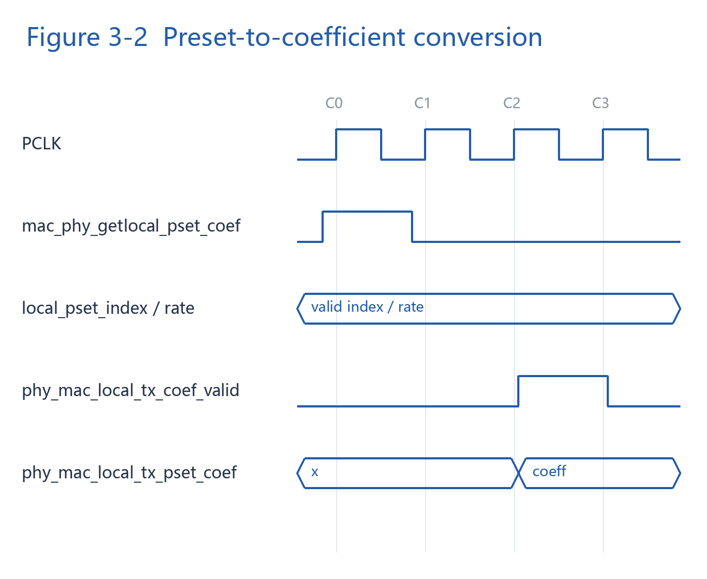
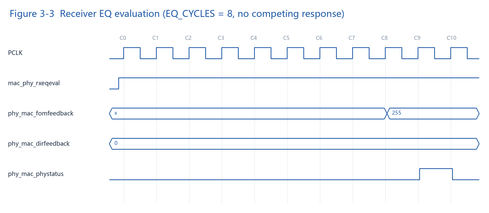

# pcie_pipe_link

## 1. Overview

### 1.1 Module Summary

`pcie_pipe_link` connects the PIPE interfaces of two PCIe controllers, forwards data between them, and provides simplified PHY interface responses and status feedback.
This module is provided for reference.

- `dsp_*` connects to a Downstream Port, such as an RP.
- `usp_*` connects to an Upstream Port, such as an EP.

Main features:

- Gen1 through Gen5 operation.
- Fixed PIPE data width of 32 bits per lane.
- Reset and rate-change responses.
- Emulated preset-to-coefficient timing and values.
- Emulated low-power states.
- No TxMargin, compliance, local loopback, or polarity-inversion functionality; FS/LF feedback uses fixed values.


*Figure 1-1. Example PCIe controller connection*

`huixi_g4x4(dsp)` and `huixi_g4x4(usp)` are example PCIe controller instances on the DSP and USP sides, respectively.

## 2. Interface Description

### 2.1 I/O List

All directions are relative to `pcie_pipe_link`. `NL` is the number of lanes per side. The `side_` prefix represents two separate sets of ports, with `dsp_` and `usp_` prefixes. For example, `side_mac_phy_rate` represents `dsp_mac_phy_rate` and `usp_mac_phy_rate`.

| Type | Definition |
| :--- | :--- |
| Common | An input shared by the DSP and USP sides |
| Shared | A signal shared by all lanes on one side; each side has its own signal |
| Per-lane | An independent signal for each lane, flattened into a packed vector |

Lane 0 occupies the least significant bits. For example, lane i uses `[i*32 +: 32]` for data and `[i*3 +: 3]` for receive status.

#### 2.1.1 Parameters

| Parameter | Default | Description |
| :--- | ---: | :--- |
| `NL` | 4 | Number of lanes per side; must be greater than 0 |
| `ACK_CYCLES` | 8 | Response waiting-period parameter. Ordinary responses use local PCLK cycles; PowerDown=5/6 responses use 62.5 MHz cycles. Additional interface latency is excluded. Must be at least 1 |
| `EQ_CYCLES` | 8 | EQ evaluation waiting period per lane, in local PCLK cycles; must be at least 1 |

#### 2.1.2 Common Clock Inputs

| Port | Direction | Width | Type | Description |
| :--- | :--- | ---: | :--- | :--- |
| `pclk_62p5` | Input | 1 | Common | 62.5 MHz Gen1 source; also runs continuously in low-power states |
| `pclk_125` | Input | 1 | Common | 125 MHz Gen2 source |
| `pclk_250` | Input | 1 | Common | 250 MHz Gen3 source |
| `pclk_500` | Input | 1 | Common | 500 MHz Gen4 source |
| `pclk_1000` | Input | 1 | Common | 1000 MHz Gen5 source |

All five `pclk_*` inputs run continuously during reset, rate changes, and low-power operation. PowerDown does not turn off these inputs. Output PCLK may have an extended low interval during a rate change.

#### 2.1.3 Shared Clock, Reset, and Power Interfaces

| Port | Direction | Width per side | Type | Description |
| :--- | :--- | ---: | :--- | :--- |
| `side_pclk` | Output | 1 | Shared | Selected PCLK supplied to the local controller |
| `side_active_rate` | Output | 3 | Shared | Actual rate code after clock switching completes |
| `side_clock_ready` | Output | 1 | Shared | Local PCLK switching-complete indication |
| `side_phy_rst_n` | Input | 1 | Shared | Local active-low asynchronous reset |
| `side_mac_phy_rate` | Input | 3 | Shared | Requested rate; valid codes are 0 through 4 |
| `side_mac_phy_powerdown` | Input | 4 | Shared | Power-state request; low-power behavior is implemented for 4, 5, and 6 |
| `side_mac_phy_asyncpowerchangeack` | Input | 1 | Shared | MAC acknowledgement of asynchronous PhyStatus for PowerDown=5/6 |
| `side_phy_ref_clk_req_n` | Output | 1 | Shared | 0: reference clock requested. 1: reference clock removal permitted. Existing permission is retained between states 4, 5, and 6; the `pclk_*` inputs are not gated |
| `side_phy_mac_pipe_config_status` | Output | 32 | Shared | Constant 0 |

#### 2.1.4 MAC-to-PHY Data and Lane-Control Inputs

| Port | Direction | Width per side | Type | Description |
| :--- | :--- | ---: | :--- | :--- |
| `side_mac_phy_txdata` | Input | `NL*32` | Per-lane | Parallel data sent to the peer |
| `side_mac_phy_txdatak` | Input | `NL*4` | Per-lane | Per-byte K-character indication, forwarded unchanged |
| `side_mac_phy_txelecidle` | Input | `NL` | Per-lane | Local TX electrical-idle indication, forwarded to peer RX |
| `side_mac_phy_txdatavalid` | Input | `NL` | Per-lane | Valid-data indication, forwarded to peer RxDataValid |
| `side_mac_phy_txstartblock` | Input | `NL` | Per-lane | Start-of-block indication, forwarded to the peer |
| `side_mac_phy_txsyncheader` | Input | `NL*2` | Per-lane | Sync header, forwarded to the peer |
| `side_mac_phy_rxstandby` | Input | `NL` | Per-lane | Returned directly as local RxStandbyStatus; does not independently disable data |
| `side_mac_phy_txdetectrx_loopback` | Input | `NL` | Per-lane | Triggers an idealized receiver-detection response; P0 local loopback is not implemented |

#### 2.1.5 PHY-to-MAC Data and Lane-Status Outputs

| Port | Direction | Width per side | Type | Description |
| :--- | :--- | ---: | :--- | :--- |
| `side_phy_mac_rxdata` | Output | `NL*32` | Per-lane | Peer TX data; 0 when the channel is disabled |
| `side_phy_mac_rxdatak` | Output | `NL*4` | Per-lane | Peer TxDataK; 0 when disabled |
| `side_phy_mac_rxelecidle` | Output | `NL` | Per-lane | Peer TxElecIdle; 1 when disabled |
| `side_phy_mac_rxvalid` | Output | `NL` | Per-lane | Inverse of peer TxElecIdle when enabled; otherwise 0 |
| `side_phy_mac_rxdatavalid` | Output | `NL` | Per-lane | Peer TxDataValid; 0 when disabled |
| `side_phy_mac_rxstartblock` | Output | `NL` | Per-lane | Peer TxStartBlock; 0 when disabled |
| `side_phy_mac_rxsyncheader` | Output | `NL*2` | Per-lane | Peer TxSyncHeader; 0 when disabled |
| `side_phy_mac_rxstandbystatus` | Output | `NL` | Per-lane | Combinational feedback of local RxStandby |
| `side_phy_mac_phystatus` | Output | `NL` | Per-lane | One-cycle pulse for ordinary completion; level handshake for PowerDown=5/6 |
| `side_phy_mac_rxstatus` | Output | `NL*3` | Per-lane | 011 while TxDetectRx is asserted; otherwise 000. No physical error detection |

#### 2.1.6 EQ Interface

| Port | Direction | Width per side | Type | Description |
| :--- | :--- | ---: | :--- | :--- |
| `side_mac_phy_rxeqeval` | Input | `NL` | Per-lane | Starts EQ evaluation on a request transition from 0 to 1; completion or early cancellation produces a response |
| `side_mac_phy_rxeqinprogress` | Input | `NL` | Per-lane | Reserved; does not affect evaluation |
| `side_mac_phy_invalid_req` | Input | `NL` | Per-lane | Reserved; does not affect the idealized evaluation result |
| `side_mac_phy_getlocal_pset_coef` | Input | `NL` | Per-lane | Starts a conversion request and captures preset index and rate |
| `side_mac_phy_local_pset_index` | Input | `NL*6` | Per-lane | 6-bit preset index; lane i uses `[i*6 +: 6]` |
| `side_mac_phy_dirchange` | Input | `NL` | Per-lane | Reserved; does not affect evaluation or feedback |
| `side_mac_phy_txdeemph` | Input | `NL*18` | Per-lane | Reserved; channel effects of TX coefficients are not modeled |
| `side_phy_mac_localfs` | Output | `NL*6` | Per-lane | 47 for rate codes of 3 or above; otherwise 48 |
| `side_phy_mac_locallf` | Output | `NL*6` | Per-lane | 15 for rate codes of 3 or above; otherwise 18 |
| `side_phy_mac_dirfeedback` | Output | `NL*6` | Per-lane | Constant 0 |
| `side_phy_mac_fomfeedback` | Output | `NL*8` | Per-lane | 0 after reset; 255 after EQ completion or cancellation |
| `side_phy_mac_local_tx_pset_coef` | Output | `NL*18` | Per-lane | Conversion result: `{C+1[5:0], C0[5:0], C-1[5:0]}` |
| `side_phy_mac_local_tx_coef_valid` | Output | `NL` | Per-lane | One-cycle coefficient-valid indication |

#### 2.1.7 Reserved Interfaces

| Port | Direction | Width per side | Type | Description |
| :--- | :--- | ---: | :--- | :--- |
| `side_mac_phy_txmargin` | Input | 3 | Shared | Shared by all lanes; unused |
| `side_mac_phy_pclk_rate` | Input | 3 | Shared | Unused; MacPhyRate selects the clock |
| `side_mac_phy_width` | Input | 2 | Shared | Unused; data width is fixed at 32 bits per lane |
| `side_mac_phy_rxpolarity` | Input | `NL` | Per-lane | Unused; polarity inversion is not implemented |
| `side_mac_phy_messagebus` | Input | `NL*8` | Per-lane | Commands are not decoded |
| `side_phy_mac_messagebus` | Output | `NL*8` | Per-lane | Constant 0; no message responses |
| `side_mac_phy_txcompliance` | Input | `NL` | Per-lane | Unused |
| `side_mac_phy_lf` | Input | `NL*6` | Per-lane | Unused |
| `side_mac_phy_fs` | Input | `NL*6` | Per-lane | Unused |
| `side_mac_phy_rxpresethint` | Input | `NL*3` | Per-lane | Unused |

## 3. Interface Timing

### 3.1 Rate Change, Reset, and Data Transfer

#### 3.1.1 Rate Change

| MacPhyRate | PCIe rate | PCLK source | PCLK frequency |
| ---: | :--- | :--- | ---: |
| 0 | Gen1, 2.5 GT/s | `pclk_62p5` | 62.5 MHz |
| 1 | Gen2, 5 GT/s | `pclk_125` | 125 MHz |
| 2 | Gen3, 8 GT/s | `pclk_250` | 250 MHz |
| 3 | Gen4, 16 GT/s | `pclk_500` | 500 MHz |
| 4 | Gen5, 32 GT/s | `pclk_1000` | 1000 MHz |

`pcie_pipe_link` responds independently to rate-change requests on the DSP and USP sides.



*Figure 3-1. Gen1-to-Gen3 rate-change timing*

The example changes from Gen1 to Gen3. T0 through T9 indicate event order, not fixed cycle counts.

1. T1: the controller changes MacPhyRate from 0 to 2; RX data is disabled in both directions.
2. T2 through T5: ClockReady goes low; PCLK changes from 62.5 MHz to 250 MHz with an extended low interval.
3. T6: ActiveRate changes to 2 and ClockReady goes high.
4. T7: each lane produces a PhyStatus pulse lasting one 250 MHz PCLK cycle.

The controller holds MacPhyRate until completion. All five source clocks continue running during the change. RX data resumes when both sides use the same rate and meet the transfer conditions; this can occur before the PhyStatus response.

#### 3.1.2 Reset

`dsp_phy_rst_n` and `usp_phy_rst_n` independently reset the two sides and are active low.

| Phase | Input requirements | Interface response |
| :--- | :--- | :--- |
| Reset asserted | PhyRstN=0; 62.5 MHz source running; MacPhyRate=0 recommended | Local ActiveRate=0, ClockReady=0, PhyStatus=0, PhyRefClkReqN=0; PCLK is 62.5 MHz. Both directions have RxValid/RxDataValid=0 and RxElecIdle=1 |
| Reset released | PhyRstN goes high; source clocks continue running | Local ClockReady recovers; each lane later produces a one-PCLK-cycle initialization PhyStatus pulse |
| Data resumes | Both resets released and transfer conditions satisfied | RX data resumes in both directions |

PCLK pulse width is not guaranteed during reset. The controller remains in reset until its clock is stable. Resetting one side does not change the peer PCLK. If MacPhyRate is nonzero when reset is released, the controller also waits for the requested rate-change response.

#### 3.1.3 Data Transfer

The DSP-to-USP connections are shown below. The reverse direction is identical.

```text
dsp_mac_phy_txdata       -> usp_phy_mac_rxdata
dsp_mac_phy_txdatak      -> usp_phy_mac_rxdatak
dsp_mac_phy_txdatavalid  -> usp_phy_mac_rxdatavalid
dsp_mac_phy_txstartblock -> usp_phy_mac_rxstartblock
dsp_mac_phy_txsyncheader -> usp_phy_mac_rxsyncheader
dsp_mac_phy_txelecidle   -> usp_phy_mac_rxelecidle
~dsp_mac_phy_txelecidle  -> usp_phy_mac_rxvalid
```

RX data resumes after a short delay when both resets are released, both ClockReady signals are 1, requested and actual rates agree on both sides, both sides use the same rate, and both PowerDown values are below 4. Loss of any condition immediately disables the channel.

| RX output | Channel enabled | Channel disabled |
| :--- | :--- | :--- |
| RxData / RxDataK | Corresponding peer TX signal | 0 |
| RxDataValid / RxStartBlock / RxSyncHeader | Corresponding peer TX signal | 0 |
| RxValid | Inverse of peer TxElecIdle | 0 |
| RxElecIdle | Peer TxElecIdle | 1 |

RxValid and RxDataValid are independent. Data presented while the channel is disabled is not replayed.

### 3.2 Low-Power Interface Timing

| PowerDown | State | PhyStatus response | `phy_ref_clk_req_n` |
| ---: | :--- | :--- | :--- |
| 4 | L1 Idle / P1.CPM | One local PCLK cycle high on each lane | Existing permission is retained. Otherwise, goes high after all completion pulses return low; no AsyncPowerChangeAck required |
| 5 | L1.1 | Asynchronous four-phase handshake | Remains 1 if already high; otherwise goes high after handshake completion |
| 6 | L1.2 | Asynchronous four-phase handshake | Remains 1 if already high; otherwise goes high after handshake completion |

PowerDown=5/6 interface sequence:

1. The controller sets PowerDown, with AsyncPowerChangeAck initially 0.
2. `pcie_pipe_link` asserts PhyStatus on all lanes after a delay.
3. The controller asserts AsyncPowerChangeAck; `pcie_pipe_link` then deasserts PhyStatus.
4. The controller deasserts AsyncPowerChangeAck to finish the response.

A high `phy_ref_clk_req_n` permits reference-clock removal. Existing permission remains high for 4-to-5/6 and 5-to-6 or 6-to-5 transitions. Reset or exit from states 4/5/6 drives it low to request the reference clock. The controller holds PowerDown until the corresponding response completes.

All five `pclk_*` inputs continue running, and local PCLK continues during low-power operation. `phy_ref_clk_req_n` reports the reference-clock request only; it does not gate these clocks. The controller may use its auxiliary clock for the asynchronous 5/6 handshake. After a 5/6-to-4 transition, each lane returns a one-local-PCLK-cycle PhyStatus completion pulse.

### 3.3 Equalization Bypass

#### 3.3.1 Bypass Interface Behavior

`pcie_pipe_link` independently responds to each lane's preset-to-coefficient and RxEqEval requests. Bypass feedback uses Gen3 FS/LF=48/18 and Gen4/Gen5 FS/LF=47/15. Evaluation completion returns FOM=255 and DirectionFeedback=0.

#### 3.3.2 Preset-to-Coefficient Conversion Timing

At C0, the controller provides the conversion request, valid preset index, and rate. `pcie_pipe_link` outputs the coefficients and asserts CoefValid at C2, then deasserts CoefValid at C3. Conversion does not produce a PhyStatus response.



*Figure 3-2. Preset-to-coefficient conversion timing*

Leave a low interval between conversion requests. Read the coefficients while CoefValid is asserted.

#### 3.3.3 Receiver Equalization Evaluation Timing

The controller asserts RxEqEval and holds it high. `pcie_pipe_link` updates FOM after `EQ_CYCLES` PCLK cycles and produces a completion PhyStatus pulse. The example uses `EQ_CYCLES=8`, with no competing completion response.



*Figure 3-3. Receiver equalization evaluation timing*

The request starts at C0. FOM changes to 255 at C8, PhyStatus goes high at C9, and returns low at C10. Another completion response may delay PhyStatus, so the controller uses PhyStatus to determine completion. Leave a low interval between evaluation requests.
