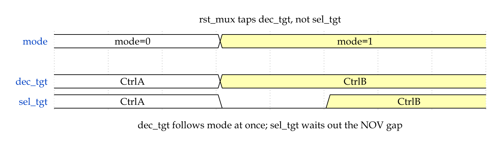
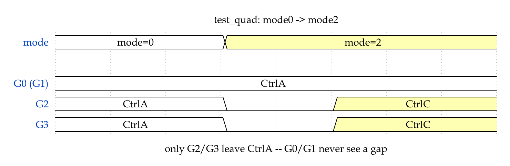
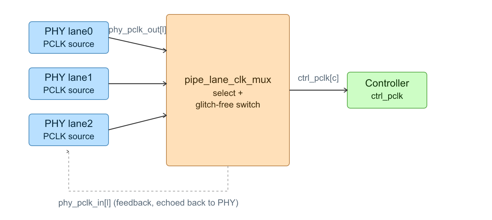
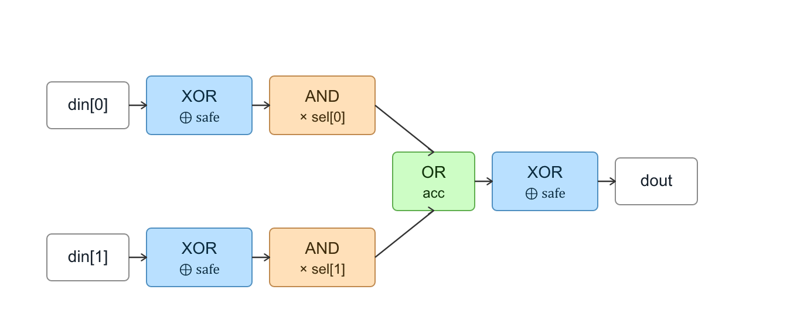
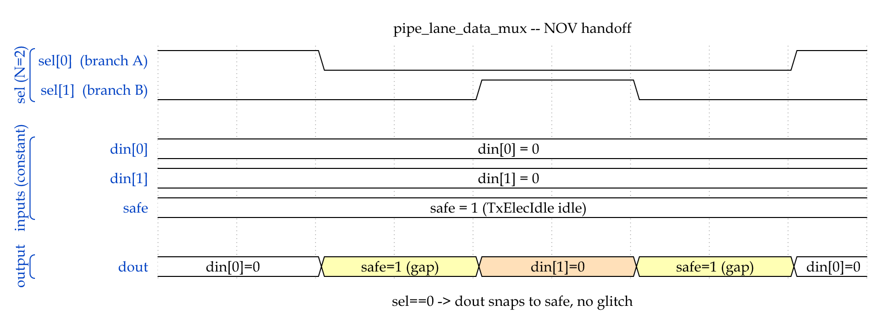
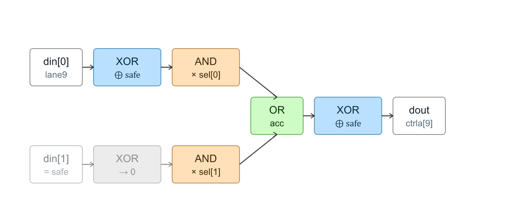

# PIPE Lane Mapper 设计要点

本文档是 PIPE lane mapper 这套 RTL 的设计文档：记录几条不直接体现在
模块代码注释里、但对理解整体架构至关重要的原理和约束。如何用生成器
把这套设计实例化成具体的 RTL/testbench（命令行参数、配置文件格式等），
见 [`src/plm/docs/tool_usage.md`](../src/plm/docs/tool_usage.md)（跟 wheel 一起打包，所以放在包里），本文档不涉及。

结构：第 1 节讲清楚要解决什么问题、由此带来哪些硬约束；第 2 节讲这套
设计支持哪些可选方案；第 3 节讲这些方案各自是怎么实现的；第 4 节汇总一批
容易踩坑、必须记住的关键点。

## 1. 需求

### 1.1 要解决的问题：动态重分配 PHY lane

多个 controller（不同宽度）共享同一组 PHY lane，需要能在运行时通过
`mode` 输入把这些 lane 重新分配给不同的 controller ——这既包括"完全没有
link 在跑，一次性配置好"的场景，也包括"某些 controller 已经在正常收发
数据，此时把剩余 lane 重新分配给别的 controller"的场景。RTL 本身不区分
这两种场景，两者用的是同一套机制（详见 2.3 节）。

### 1.2 核心硬约束：只允许扰动真正变化的部分

`mode` 切换时，只有 owner 真正发生变化的那部分 lane 才允许经历
NOV（non-overlap）切换窗口；owner 没有变化的 lane，其数据通路必须
全程不受扰动、持续正常工作。这是整个设计里最基本的一条要求——不满足
它，"动态重分配"这个用例就不成立（跑着的 link 会被无关的 mode 切换
误伤）。

### 1.3 由需求反推出的拓扑/配置约束

要保证 1.2 节的性质成立，且不引入额外的跨 group 仲裁逻辑，配置本身
必须满足几条硬约束——这些约束由 `Config.validate()` 强制检查，生成
阶段直接报错拒绝不满足条件的配置。

**约束 A：同一条 controller lane 的所有驱动源，必须来自同一个 lane
group。** `Config._build_groups()` 按"每条 lane 在所有 mode 下的
owner 序列"分组：两条 lane 只有在**所有 mode 下 owner 完全一致**时才
会被分进同一个 group，每个 group 各自拥有一套独立的 `pipe_lane_sel_sync`，
独立完成自己的 NOV 时序，group 之间互不感知、互不互锁。如果一个
controller lane 由跨 group 的多路 lane 驱动，这些驱动源各自收敛的时刻
是独立的、没有互锁关系，可能出现短暂同时有效，导致下游汇聚 mux 把两路
数据相或——这个代价在 RTL 层面很难低成本解决，所以在拓扑层面直接约束
掉（详见 3.2 节分组算法、3.4 节"只扰动变化部分"是怎么由这条约束保证的）。

**约束 B：每个 controller 的工作时钟必须固定，不能跟着 mode 切换换
源，只能换宽度。** 换时钟源需要额外的无毛刺切换电路，且这类切换本质上
仍是 non-overlap——切换窗口期间 controller 逻辑状态该丢的还是会丢，
效果上跟"直接换时钟源、controller 复位重来"没有本质区别，但电路复杂
得多。所以设计上直接禁止：一旦某 controller 在不同 mode 下算出的工作
时钟候选数 > 1，`validate()` 直接报错（详见 4.2 节）。

**建议 C：controller 数量宜与"总 lane 数 / 最小分配颗粒度"对齐（仅警告，不拦截）。**
即使每个 controller 各自的最低编号 lane 都固定不变，如果 controller
的**数量**跟 PHY 的 lane 资源、最小分配颗粒度对不上，也会间接破坏约束
B，或者造成资源浪费：

- **数量偏多**：一定有 controller 在所有配置下都分不到 lane（僵尸
  controller，`validate()` 中已有单独校验：某 controller 在所有 mode
  下都没有被使用则报错）。
- **数量偏少**：为了不浪费 lane，可能被迫在某些 mode 下让某个 controller
  拿到比最小颗粒度更多的 lane，从而挤压其它 controller 的分配，间接
  导致某 controller 的最低编号 owned lane 在不同 mode 下漂移——与约束
  B 冲突。

`Config._min_granularity()` 从 `lane_mapping.csv` 的实际数据反推每个
controller 拥有 lane 时的最小宽度，取全局最小值 `g_min`，`Config.warnings()`
中据此检查，不满足时只在报告里给出警告：

```
lane_count % g_min == 0                     # 否则无法被这个颗粒度均分
len(controllers) == lane_count // g_min     # 数量必须与理想值一致
```

现有的三套配置（`dpr`：颗粒度 3、4 controller；`bifurcate`：
颗粒度 4、4 controller；`finegrain`：颗粒度 1、6 controller）均满足
此式。

它不是硬约束：它想防的两种后果（controller 永远分不到 lane、工作时钟
漂移）已由 `validate()` 直接报错，而 x16 拆成 x8+x4+x4 这类 3 个
controller 的合法拓扑并不满足此式。

完整的校验规则清单见 4.3 节表 1。

### 1.4 模块边界与外部前置条件

Lane Mapper 是 controller 与 PHY 之间的**纯切换层**。它只根据已经给定的
`mode`/`v_lane_mask` 路由 PIPE 数据、时钟和复位，并在需要换 owner 的
Group 内完成 non-overlap 切换。它不是模式控制器，也不负责判断 PCIe Link
当前能否切换。

因此，以下工作明确属于 Mapper 外部：

- 决定何时改变 `mode` 或 `v_lane_mask`；
- 让 owner 将发生变化的 Group 停止使用对应 PIPE lane；
- 根据系统方案完成必要的 Controller/PHY 静默、复位和链路恢复；
- 保证 `mode` 是合法、无组合毛刺的配置值，并在一次切换收敛期间保持稳定；
- 保证 DPR 的 `v_lane_mask` 按 Group 整体置位，同一 Group 内只能全 0 或全 1；
- 保证输入时钟和复位满足所选 PCLK 架构的接口要求。

Mapper 不生成 `request/busy/done` 一类系统级握手，也不实现 LTSSM、链路训练、
协议恢复或策略仲裁。owner 未变化的 Group 不受切换影响；owner 发生变化的
Group 在外部满足上述前置条件后，由 Mapper 负责完成实际路由切换。

## 2. 支持的模式

本设计有两组相互独立、各自二选一的可选方案，以及两种不区分实现、只是
使用方式不同的场景。

### 2.1 时钟架构：两种 PCLK 归属方案

PIPE 规范允许两种截然不同的 PCLK 归属方式，两者互斥，一次只能选择
一种（`gen_clk_mux()` / `gen_sel_gen()` / `gen_data_m2p()` /
`gen_data_p2m()` / `gen_top()` / `gen_tb()` 等生成逻辑都按所选方案
分叉）：

> **命名视角**：`input` / `output` 都是相对于 **PHY 的 PCLK 端口方向**，
> 不是相对于 Lane Mapper。`pclk_as_phy_output` 表示 PCLK 从 PHY 流出；
> `pclk_as_phy_input` 表示 PCLK 流入 PHY。

| | `pclk_as_phy_output`（默认方案） | `pclk_as_phy_input` |
|---|---|---|
| PHY 端口方向 | PHY output | PHY input |
| PCLK 由谁产生 | PHY 产生，送往 controller | controller 由外部参考时钟分频产生，送往 PHY |
| 正向 PCLK 路径 | `phy_pclk_out[l]` → Mapper → `ctrl_pclk[c]` | `{c}_pclk[port]` → Mapper → `phy_pclk[l]` |
| PHY 返回时钟 | 不单独使用 `rx_clk` | `rx_clk[l]` → Mapper → `{c}_rx_clk[port]` |
| controller 的工作时钟从哪来 | `pipe_lane_clk_mux` 从当前 owner 所在 lane 的 `phy_pclk_out` 里选一路，即 `ctrl_pclk` | controller 自己用参考时钟分频得到，按自己的 lane 输出成 `{c}_pclk[]`，本设计不参与产生 |
| 有没有 `ctrl_pclk` 信号 | 有（顶层输出） | 没有（详见 3.5.2 节） |
| 数据路径的同步粒度 | 按 group（`sel_tgt`，group 级信号） | 按物理 lane（`seltgt_gN_lL`，详见 3.5.2 节） |
| DPR 时钟 | Mapper 从当前 mask 中最低编号 lane 的 `phy_pclk_out` 派生 `dpr_pclk` | 系统外部提供持续运行的 `dpr_pclk`；Mapper 输出逐 lane `dpr_rx_clk[]` |

`pclk_as_phy_output` 是最早支持的方案，实现细节见 3.5.1 节；
`pclk_as_phy_input` 是后加的第二种方案，实现细节见 3.5.2 节。两者
生成的顶层端口列表、内部信号完全不同，不能混用。

### 2.2 NOV 同步策略：`sync` / `comb` 两种

`sel_tgt` / `seltgt_gN_lL` 最终都要经过 `pipe_lane_sel_sync`
（`tool/common/pipe_lane_sel_sync.sv`）产生，其 `SYNC` 参数决定走
哪种策略：

- `sync`（开 DPR 时，`SYNC=1'b1`）：真正的 non-overlap + 两级同步器，跨
  时钟域安全，每次切换都会经过一段真实的全 0 窗口。
- `comb`（不开 DPR 时，`SYNC=1'b0`）：`en` 直接等于 `tgt`，纯组合透传，
  没有寄存器、没有同步。前提是**只在受影响的 lane 处于复位时切换
  `mode`**：这样选择信号在 lane 工作期间是静态的，同步没有意义。在工作中
  的 lane 上切 `mode`，多个分支可能短暂同时为 1，`pipe_lane_data_mux`
  会把两路数据相或。

这条前提由生成的 testbench 落实（生成的可综合 RTL 里不放断言）：不开
DPR 时，testbench 按"拉低相关 controller 复位 → 切 `mode` → 释放
复位"的顺序切换，并带一个监视块，`mode` 变化时若有 lane 换 owner 而
新旧 owner 的 `rst_n` 没有同时为低就记一条错误、`TB_RESULT` 判 FAIL。
集成环境需要自己遵守这条约定。

选哪种不是用户选项，由是否开 DPR 决定：不开 DPR 时归属只随 `mode`
变化，而 `mode` 只在复位期间切换；开 DPR 后 `v_lane_mask` 会在运行中
变化，必须走 `sync`。

这个策略是 `pipe_lane_mapper` 顶层的一个 `localparam`（`SEL_SYNC`），不是
生成阶段写死进每个实例的字面量——`pipe_lane_sel_gen` 里所有数据路径的
`pipe_lane_sel_sync`（`sel_tgt`/`seltgt_gN_lL` 那些）统一接到这一个
参数上，值从顶层一路传下去。顶层和 connection 包装层把它（连同
`NL`/`NC`）声明成 `localparam`，例化时不能覆盖；是否开 DPR 决定它的值。

`rx_clk`、controller pclk 候选切换这些无毛刺时钟切换用的
`pipe_lane_sel_sync`（3.5.2 节 `u_rxclk_sel_sync_*`、3.5.1 节
`u_pclk_sel_sync_*`）**不**接这个参数，永远硬编码 `SYNC=1'b1`——它们
门控的是时钟本身，这条安全性质不应该由使用者关掉（呼应 4.1 节）。

这两种模式对 `safe_state`/`tie_off` 是否真正生效有直接影响，详见 4.4
节。

### 2.3 使用场景：静态配置 vs 动态重分配

`mode` 输入和分组 NOV 是同一套机制，RTL 本身不区分下面两种使用场景
——是否"安全"完全由 3.2/3.4 节的分组规则保证，不依赖任何运行时判断
"现在有没有活跃 link"。

**静态配置**：没有活跃 link 时一次性配置。典型时序是保持
`ctrl_rst_n` 为 0、把 `mode` 设好，再放开 `ctrl_rst_n`（tb 里的做法）。
此时所有 controller 都还没有实际在跑数据，不存在"谁的 link 不能被
打扰"的问题；`sel_tgt`/`seltgt_gN_lL` 一次性落定，效果上等同于一张
固定路由表；换到另一套分配方案需要整体下电、重新走"复位保持 + 改
mode + 放开复位"的流程。

**动态重分配**：某条 link 正在跑数据时，把剩余 lane 重新分配给别的
controller。这是本设计真正要解决的场景（对应 1.1/1.2 节的需求），
核心保证是"改 mode 只会触碰 owner 真正变化的 group，owner 未变的
group 全程不受扰动"，实现方式见 3.4 节。

一句话总结：动态重分配用的就是"改 mode"这同一个操作，只是发生在有
link 已经跑起来的时候；静态配置是同一个操作只发生一次、发生在还没有
link 跑起来的时候。

## 3. 实现方法

### 3.1 模块层次

```
pipe_lane_mapper_connection (可选的 flat 包装层，见下)
 └─ pipe_lane_mapper
     ├─ u_mode_dec   (pipe_lane_mode_dec)  mode 译码，纯组合输出 dec_tgt
     ├─ u_sel_gen    (pipe_lane_sel_gen)   各 group/lane 的 pipe_lane_sel_sync，输出同步后的选择信号
     ├─ u_clk_mux    (pipe_lane_clk_mux)   两套时钟架构各自的 PCLK 生成/路由 + 无毛刺切换
     ├─ u_rst_mux    (pipe_lane_rst_mux)   复位 mux，接 dec_tgt（未同步，随 mode 立即变化）
     ├─ data_m2p / data_p2m                按同步后的选择信号做数据汇聚/分发
     └─ pipe_lane_signal_pkg              公共参数/类型定义
```

`u_rst_mux` 特意接的是 `dec_tgt`（译码器原始输出）而不是 `sel_gen` 对外
同步后的选择信号，目的是让复位控制随 mode 立即变化，不必等待
`pipe_lane_sel_sync` 完成同步和 NOV 窗口——两者的差异见 3.3 节图 1。

`pipe_lane_mapper` 的 PIPE 数据端口本身是两个 struct 数组（PHY 侧一个，
每个 controller 一个，字段来自 `pipe_signals.csv`），不是拉平的信号列表
——这是设计本身，不是过渡态。`pipe_lane_mapper_connection` 是随
`pipe_lane_mapper.sv` 一起自动生成的纯包装模块，实例化 mapper 本体，把
这两个 struct 端口展开成一个个 flat 信号端口，给不想处理 SV struct 端口
的下游流程/IP 用；mapper 本体完全不知道这层包装的存在。

`pipe_signals.csv` 的 `signal_type` 列（`perlane`/`shared`）只影响这个
包装层怎么给某个 controller 展开端口：`perlane`（默认）展开成该
controller 自己 `max_width` 条 lane 的数组；`shared` 收缩成一个标量端口
——同一个 controller 自己的所有 lane 只有一个值（比如真实 PIPE 里的
Rate/PowerDown，一个 controller 通常是整条 link 一起变，不是逐 lane
变）。PHY 侧不受这个字段影响，永远按 lane 展开——一条 PHY lane 当前属于
哪个 controller 本来就随 mode 变化，即使某个信号在 controller 自己的
lane 之间是共享的，PHY 侧仍然需要每条 lane 各自的值。当前版本只允许
MAC→PHY 信号使用 `shared`：包装层把一个 controller 标量复制到它的每条
lane。PHY→MAC 信号必须是 `perlane`，配置成 `shared` 会在生成前报错。

### 3.1.1 各模块端口一览

`{c}` 代表某个 controller 的 `lname`（比如 `ctrla`）；标 dpr 的端口只在
`--dpr` 时才存在，标 phy_as_phy_output/phy_as_phy_input 的端口只在对应
`--pclk-mode` 下才存在，两者互斥。宽度里的 `NL`/`NC` 是模块参数（顶层和包装层为 localparam），
每个 controller 自己的端口按它在 `controllers.csv` 里的 `max_width`
各自定宽（不同 controller 可以不同宽）。

**`pipe_lane_mapper`**（顶层 DUT）——localparam `NL`、`NC`、`SEL_SYNC`（由配置固定，例化时不可覆盖）

| 端口 | 方向 | 存在条件 | 说明 |
|---|---|---|---|
| `phy_pclk_out[NL]` | in | pclk_as_phy_output | PHY 每条 lane 自己的 PCLK |
| `rx_clk[NL]` | in | pclk_as_phy_input | PHY 每条 lane 的恢复时钟 |
| `mode` | in | 总是 | 位宽按 `$clog2(模式数)` |
| `phy_pclk_in[NL]` | out | pclk_as_phy_output | 回灌给 PHY 的反馈时钟 |
| `phy_pclk[NL]` | out | pclk_as_phy_input | 无毛刺选出的每 lane 工作时钟 |
| `phy_rst_n[NL]` | out | 总是 | 每条 lane 当前 owner 的复位 |
| `phy_mac2phy[NL]` / `phy_phy2mac[NL]` | out/in | 总是 | PHY 侧数据，struct 数组 |
| `v_lane_mask[NL]` / `dpr_rst_n` | in | dpr | DPR 的实时掩码、复位 |
| `dpr_mac2phy[NL]` / `dpr_phy2mac[NL]` | in/out | dpr | DPR 自己的数据端口，1:1 对应 lane |
| `dpr_pclk` | out | dpr + phy_as_phy_output | 从 PHY 输出 PCLK 中无毛刺选出的 DPR 工作时钟 |
| `dpr_pclk` | in | dpr + phy_as_phy_input | DPR 外部提供的自由运行工作时钟；接管前后都不能停 |
| `dpr_rx_clk[NL]` | out | dpr + phy_as_phy_input | DPR 接管 lane 后收到的逐 lane PHY 恢复时钟；未接管时为 0 |
| `{c}_rst_n` | in | 每个 controller | 已在外部同步好 |
| `{c}_mac2phy[max_width]` / `{c}_phy2mac[max_width]` | in/out | 每个 controller | struct 数组，按它自己的 lane 数定宽 |
| `{c}_pclk[max_width]` | in | 每个 controller + phy_as_phy_input | 每条 controller lane 一位，controller 自己分频好送进来 |
| `{c}_rx_clk[max_width]` | out | 每个 controller + phy_as_phy_input | 无毛刺路由回给它的 rx_clk |
| `{c}_pclk` | out | 每个 controller + phy_as_phy_output | controller 自己的单一工作时钟，标量 |

**`pipe_lane_mapper_connection`**（可选 flat 包装层）——localparam 同上

跟 `pipe_lane_mapper` 端口形状一致，只有两处不同：PHY 侧和每个
controller 的 `mac2phy`/`phy2mac` struct 数组按 `pipe_signals.csv` 逐行拆
成独立的 flat 信号（`phy_{signal}[NL]`、`{c}_{signal}`，`signal_type=shared`
的收缩成标量，见 3.1 节）；其余端口（`{c}_rst_n`/`{c}_pclk`/`{c}_rx_clk`/
`mode`/时钟/复位/DPR）原样透传，命名和方向都不变。

**`pipe_lane_sel_gen`**——parameter `NC`，`NL`（phy_as_phy_input 或 dpr 时才有）、`SEL_SYNC`

| 端口 | 方向 | 存在条件 | 说明 |
|---|---|---|---|
| `mode` | in | 总是 | |
| `ctrl_pclk[NC]` | in | phy_as_phy_output | 各 controller 当前工作时钟，来自 clk_mux |
| `{c}_pclk[max_width]` | in | 每个 controller + phy_as_phy_input | 同 pipe_lane_mapper 里那个 |
| `ctrl_rst_n[NC]` | in | 总是 | |
| `rx_clk[NL]` | in | phy_as_phy_input | |
| `v_lane_mask[NL]` / `dpr_rst_n` / `dpr_pclk` | in | dpr | |
| `sel_tgt` (`lane_sel_t`) | out | phy_as_phy_output | 每 group 同步后的有效选择 |
| `dec_tgt` (`lane_sel_t`) | out | 总是 | 译码器原始（未同步）选择，dpr 时已经把 DPR 合成进去 |
| `pclk_tgt_c{cid}` | out | 每个多候选 controller | 传给 clk_mux 做自己时钟的无毛刺切换 |
| `seltgt_g{gid}_l{l}` | out | phy_as_phy_input，每条非 direct（或 dpr 时全部）group 的每条 lane | 同步进该 lane 当前候选自己那条 controller lane 的时钟域的选择位 |
| `rxclk_en_g{gid}_l{l}` | out | phy_as_phy_input，每条非 direct（或 dpr 时全部）group 的每条 lane | 同步进 `rx_clk[l]` 域的选择位；同时控制 RX 时钟和 PHY→MAC 数据归属 |

**`pipe_lane_clk_mux`**——parameter `NL`、`NC`；两种模式端口完全不同

phy_as_phy_output：`phy_pclk_out[NL]`、`ctrl_rst_n[NC]`、每个多
候选 controller 的 `pclk_tgt_c{cid}`、`sel_tgt`、（dpr：`v_lane_mask[NL]`、
`dpr_rst_n`）→ `ctrl_pclk[NC]`、（dpr：`dpr_pclk`）、`phy_pclk_in[NL]`。

phy_as_phy_input：`ctrl_rst_n[NC]`、`rx_clk[NL]`、每个
controller 的 `{c}_pclk[max_width]`、每条非 direct（或 dpr 时全部）group
每条 lane 的 `seltgt_g{gid}_l{l}`、每条非 direct（或 dpr 时全部）group 每条
lane 的 `rxclk_en_g{gid}_l{l}`、（dpr：外部 `dpr_pclk`）→ `phy_pclk[NL]`、
每个 controller 的 `{c}_rx_clk[max_width]`、（dpr：`dpr_rx_clk[NL]`）。

**`pipe_lane_rst_mux`**——parameter `NL`、`NC`

`ctrl_rst_n[NC]`、（dpr：`dpr_rst_n`）、`sel_tgt`（顶层实际接的是
`dec_tgt`，见 3.1 节）→ `phy_rst_n[NL]`。

**`pipe_lane_data_m2p`**（MAC→PHY 数据 mux）——parameter `NL`

phy_as_phy_input 时用每条 group 每条 lane 的 `seltgt_g{gid}_l{l}`，否则
用 `sel_tgt`；`phy_mac2phy[NL]` 输出；（dpr：`dpr_mac2phy[NL]` 输入）；
每个 controller 的 `{c}_mac2phy[max_width]` 输入。

**`pipe_lane_data_p2m`**（PHY→MAC 数据 mux）——parameter `NL`

同样按模式用 `seltgt_g{gid}_l{l}` 或 `sel_tgt`；`phy_phy2mac[NL]` 输入；
（dpr：`dpr_phy2mac[NL]` 输出——在这个模块、顶层和可选的flat包装层都按
lane保留；当前版本禁止PHY→MAC信号配置成`shared`）；
每个 controller 的 `{c}_phy2mac[max_width]` 输出。

**`pipe_lane_signal_pkg`**——不是模块，是 package：`mac2phy_lane_t`/
`phy2mac_lane_t`（PIPE 数据 struct）、`SAFE_M2P`/`SAFE_P2M`（safe_state
常量，16 进制字面量）、`mode_sel_t`/`lane_sel_t`（dec_tgt/sel_tgt 用的
per-group 选择 struct，dpr 时 `lane_sel_t` 每个字段多一位给 DPR）。

### 3.2 Lane 分组算法

`Config._build_groups()` 按"每条 lane 在所有 mode 下的 owner 序列"
分组：两条 lane 只有在所有 mode 下 owner 完全一致时才会被分进同一个
group。这个分组规则不是任意选择，而是由 1.3 节约束 A 反推出来的——
保证每个 group 能独立、无需跨 group 互锁地完成自己的 NOV 判断。

`Config._min_granularity()` 反推的最小颗粒度、以及数量对齐检查
（1.3 节建议 C）都建立在这个分组结果之上。

### 3.3 dec_tgt 与 sel_tgt：两级选择信号

`pipe_lane_mode_dec` 产生的 `dec_tgt` 是纯组合输出，`mode` 变化后同一
拍就反映新的 owner；这个原始值经过 `pipe_lane_sel_gen` 里的
`pipe_lane_sel_sync` 同步之后，才变成真正驱动数据通路/时钟切换的信号
（`pclk_as_phy_output` 模式下是 group 级的 `sel_tgt`，`pclk_as_phy_input`
模式下是按 lane 拆开的 `seltgt_gN_lL`，见 3.5.2 节）。



**图 1**：`mode` 变化时，`dec_tgt`（纯组合）同一拍就反映新的 owner；
`sel_tgt`（`pipe_lane_sel_sync` 同步后）要先经过一段全 0 的 NOV 窗口
才会落到新值。`rst_mux` 用 `dec_tgt` 正是为了不被这段延迟拖慢复位
时机；`sel_tgt`/`seltgt_gN_lL` 则必须经过这段延迟，才能保证 3.4 节
说的"安全切换"。

### 3.4 NOV 切换流程，以及"只扰动变化部分"是怎么被保证的

模式切换（比如 mode0 → mode1）不会让所有 lane 都进入 NOV 切换过程，
只有 owner 在这次切换前后确实发生变化的那些 group，才会让自己的选择
信号翻转、进而触发 `pipe_lane_sel_sync` 走一次 NOV 窗口：先归零
（安全态）、旧 owner 断开、新 owner 建立，期间 `pipe_lane_data_mux`
保证呈现的是安全值（m2p 方向是 `safe_state`，p2m 方向是 `tie_off`，
见 3.6 节），而不是悬空或两路相或——这个保证只在 `sync` 模式下成立，
`comb` 模式下选择信号不会真的停在全 0（见 2.2 节）。

owner 没有变化的 group，它对应的选择信号在切换前后取值相同，
`pipe_lane_sel_sync` 检测不到翻转，根本不会进入切换窗口——这些 lane
的数据通路全程没有被扰动，仍然正常工作。这不是靠额外互锁逻辑保证的，
而是"按 owner 序列分组（3.2 节）+ 组间独立判断切换"这个设计本身自带
的性质；3.2 节的分组约束存在的意义，正是保证每个 group 能独立判断
"要不要切"而不用跟别的 group 互锁。

例（`dpr`）：mode0→mode2 只切换 G2、G3，G0/G1 不受影响。若
CtrlA 当时正靠 G0+G1（lane0~5）在跑，这次改 mode 完全不影响它，同时
G2/G3 从 CtrlA 断开、切给 CtrlC。



**图 2**：同一次 `mode0 → mode2` 切换里，G0/G1（图中合并为一行，owner
全程是 CtrlA）从未离开过 CtrlA，`sel_tgt` 对应位不翻转，也就没有 NOV
窗口；只有 owner 真正变化的 G2、G3 各自独立地经历"先归零、再落到新
owner"的窗口。

### 3.5 clk_mux 实现

`pipe_lane_clk_mux` 是两套时钟架构方案（2.1 节）差异最大的模块，
下面分别说明。

#### 3.5.1 `pclk_as_phy_output` 模式：`ctrl_pclk` 生成 + 反馈时钟 mux

`ctrl_pclk_src()` / `ctrl_pclk_cands()`：每个 controller 的工作时钟
（`ctrl_pclk`，不是参考时钟）固定使用它在当前 mode 下"组内编号最低的
那条 owned lane"的 `phy_pclk_out`。



**图 3**：蓝色——每条 PHY lane 各自产生自己的 PCLK（`phy_pclk_out[l]`），
时钟由 PHY 产生、驱动出来，不是 MAC 提供参考时钟给 PHY。橙色——
`pipe_lane_clk_mux` 从当前 owner 所在 lane 的 `phy_pclk_out` 里选
一路，作为这个 controller 的 `ctrl_pclk`。绿色——controller 拿到
`ctrl_pclk` 作为自己的工作时钟。虚线——选中的这路时钟又被送回去驱动
这组 lane 的 `phy_pclk_in`，形成一个 phy→mac→phy 的环。

如果某 controller 在不同 mode 下"最低编号 owned lane"发生了变化（1.3
节约束 B 已经禁止这种配置通过 `validate()`），驱动它的工作时钟源就会
变，需要 `pipe_lane_sel_sync` + `pipe_lane_clk_gate` 做无毛刺切换
（先安全关断旧时钟，等新时钟稳定再打开新时钟）——`ctrl_pclk_cands()`
长度 > 1 的代码路径因此在现有配置里从未被真实触发过，只是防御性地
保留着。

#### 3.5.2 `pclk_as_phy_input` 模式：`phy_pclk` / `rx_clk` 无毛刺切换

![PCLK as PHY input：外部 PLL 给每个 controller 一路参考时钟，controller 自己分频出 pclk[] 送回 PHY（按 lane 无毛刺切换），PHY 的 rx_clk[] 送回给 controller（同样按 lane 无毛刺切换，只是同步目标换成 rx_clk[l] 自己的域）；没有单独的 ctrl_pclk 信号，sel_gen 按每个候选自己的端口位同步](images/pclk_max_pclk.png)

**图 4**：紫色——每个 controller 有自己独立的外部 PLL 参考时钟
（未分频，不是 controller 的真实工作时钟，也不是
`pipe_lane_mapper` 的顶层端口——它是外部 PLL 直接给 controller
的信号，分频这一步发生在 `pipe_lane_mapper` 范围之外）。绿色——
controller 自己做分频，
分频结果按自己每条 lane 一位的形式输出成 `{c}_pclk[]`，格式和
`{c}_mac2phy` 完全一样。橙色——`pipe_lane_clk_mux` 负责两个方向的
转换：`{c}_pclk[]` 经过无毛刺切换变成 `phy_pclk[l]` 送给 PHY；PHY 的
`rx_clk[l]` 经过另一套独立的无毛刺切换变成 `{c}_rx_clk[]` 送回
controller。蓝色——PHY。

这套架构里**没有** `ctrl_pclk` 信号（既不是顶层端口，也不是内部
wire）：`pclk_as_phy_output` 模式下 `ctrl_pclk` 是真实存在的一路信号，因为
controller 自己造不出这路时钟，需要 `pipe_lane_clk_mux` 从
`phy_pclk_out` 候选里选出来再喂给它；这套架构里恰好相反——controller
自己已经用参考时钟分频出了工作时钟，并按自己的 lane 送出来
（`{c}_pclk[]`），`pipe_lane_clk_mux`/`pipe_lane_mapper` 不需要
再算出一路 `ctrl_pclk` 还给 controller，那只是把某一位换个名字
重新送回去、没有实际作用。`{c}_pclk[]` 才是唯一真实存在的时钟来源，
而且是**按 controller 自己的 lane**的，不是按 controller 一根——这一点是这套架构里最
重要的性质，直接决定了下面几段的实现方式（也是 4.5 节要重点强调的
关键点）。

**`seltgt_gN_lL`：数据路径的选择信号按物理 lane 拆分。** `pclk_as_phy_output`
模式下选择信号是按 group 共用一份（`sel_tgt`），因为 `ctrl_pclk` 天生
就是"这个 controller 唯一的一根内部时钟"。但 `pclk_as_phy_input`
模式下 `{c}_pclk[]` 本来就是按 controller 自己的 lane 给的（一个 x4/x8/x2 的配置，合计
就是 4+8+2=14 根，不是 3 根）——"controller 只有一根内部时钟"这个
前提不成立，选择信号驱动的 `pipe_lane_data_mux` 输出最终会被
controller 自己**那条具体 lane** 的 `{c}_pclk[]` 采样，所以同步目标
也必须是这条具体 lane 自己的域，不能用某个候选任意一位（比如
`{c}_pclk[0]`）代表整个 controller。因此 `pipe_lane_sel_gen` 里每条
BBM lane 单独建一棵 `pipe_lane_sel_sync`：

```systemverilog
// pipe_lane_sel_gen 内部，每条 BBM lane 一个（不是每个 group 一个）：
pipe_lane_sel_sync #(.N(n), .SYNC(sync_mode)) u_seltgt_sel_sync_gN_lL (
    .branch_clk   ({ctrld_pclk[port_d], ctrlc_pclk[port_c], ...}),  // 每个候选自己在这条 lane 上的那条 ctrl lane
    .branch_rst_n (...),
    .tgt          (dec_tgt.gN),
    .en           (seltgt_gN_lL)
);
```

`gen_data_m2p()`（一条 lane 收敛多个候选）直接用这条 lane 自己的
`seltgt_gN_lL` 当 `.sel`；`gen_data_p2m()`（多条 lane 收敛到一个
controller lane）按分支逐位拼：每个候选 `i` 只关心它自己那条
designated lane 的第 `i` 位（`seltgt_gN_l{它自己的lane}[i]`），拼成
一个跟原来 `sel_tgt.gN` 形状一样的向量喂给 `pipe_lane_data_mux`。
group 级的 `sel_tgt`（`lane_sel_t`）在这套架构里因此不存在，
`pipe_lane_sel_gen` 只在 `pclk_as_phy_output` 模式下才产出它；tb 里的 NOV
监控（one-hot0 检查 + sel==0 时的安全态检查）相应地改成按每条 lane
各自监控 `dut.seltgt_gN_lL`。

**`phy_pclk`：无毛刺切换按物理 lane 独立进行，但复用同一份同步结果。**
`pclk_as_phy_output` 模式的反馈时钟切换是按 group 做的一份，因为它选的是
`ctrl_pclk[c]`——每个 controller 只有一路，同一个候选 controller 在
同一个 group 里对所有 lane 都是同一路时钟，可以共用一组
`pipe_lane_clk_gate`。这套架构里 `phy_pclk` 选的是
`{c}_pclk[]`——按 controller 自己的 lane 的，不是按 controller 的，所以每条物理 lane
的 `pipe_lane_clk_gate` 都要独立一份，`clk_in` 接这条 lane 对应的那个
具体那一位。但驱动这些 `clk_gate` 的 `en`，不需要再单独同步一次——
上面 `seltgt_gN_lL` 本来就是拿同一组 `branch_clk`（每个候选自己在这条
lane 上那条 ctrl lane）同步出来的，直接复用即可：

```systemverilog
// pipe_lane_clk_mux 内部，直接消费 sel_gen 传来的 seltgt_gN_lL，不再自己建同步树：
pipe_lane_clk_gate u_pclk_gate_gN_lL_bI (
    .clk_in ({c}_pclk[port]), .en (seltgt_gN_lL[i]), .clk_out (...)
);
```

`dec_tgt` 因此只需要同步进两类域：这里（数据路径 + `phy_pclk` 共用）
和下面的 `rx_clk[l]`，不是三类。当前（分频逻辑还没实现）同一个
controller 所有 lane 事实上是同一路时钟，这份"按 lane 独立"只是为了
从设计上保证正确——真的接上分频器之后不需要再改这部分电路。

多个候选 `pipe_lane_clk_gate` 门控之后要合成一路，这个 OR 不直接用
SystemVerilog 的 `|` 归约，而是过一个专门的 `pipe_lane_clk_or` 模块
（跟 `pipe_lane_clk_gate` 一样，默认是行为级实现，留了
`PIPE_USE_CLKOR_CELL` 的开关，真正流片时换成工艺库的时钟 OR/mux
cell）——多路已经无毛刺的时钟合成一路，在通用标准单元库里同样不是
随便一个 OR cell 就能保证时序收敛的，需要专门的时钟树单元，跟"门控
时钟不能用普通 AND"是同一类考量。这个模块在两套时钟架构里通用。

**`rx_clk`：独立的第三个时钟域，需要自己单独一棵同步树。**
`{c}_rx_clk[]` 的路由拓扑和 `{c}_pclk[]` 一样（同一个 mode 下、同一个
owner、同一个 ctrl lane 下标），但 `rx_clk[l]` 是这条物理 lane 自己的 PHY CDR
恢复时钟，跟 `{c}_pclk` 没有固定相位关系，是一个完全独立
的时钟域——不能直接拿同步进 `{c}_pclk` 域的 `seltgt_gN_lL` 去门控
`rx_clk[l]`，那样 `rx_clk[l]` 相对这个使能信号仍然是异步的，
`pipe_lane_clk_gate` 的锁存器要求 `en` 必须已经同步进 `clk_in`（这里
就是 `rx_clk[l]`）自己的域（详见 4.1 节的 CDC 基本原则），否则一样
有毛刺/亚稳态风险。

正确做法和 `phy_pclk` 同一个思路，只是主客对调：`phy_pclk` 是"多个
候选时钟里选一个接到固定的输出"，`rx_clk` 是"一个固定的时钟源
（`rx_clk[l]`）分给当前的 owner controller"。所以每条 BBM lane 建一棵
**新的** `pipe_lane_sel_sync`，`branch_clk` 的 N 路全部填这条 lane
自己的 `rx_clk[l]`（把 `dec_tgt.gN` 同步进 `rx_clk[l]` 域，产生
`rxclk_en_gN_lL`），再用 `pipe_lane_clk_gate`（`clk_in` = `rx_clk[l]`）
给每个候选 controller 各自的 `{c}_rx_clk[port]` 门控——这里不需要像
`phy_pclk` 那样最后 OR 起来，因为每个候选的输出本来就是各自独立
的线，不共享。direct group（没有切换）维持直接 `assign`，不用改。

### 3.6 `pipe_lane_data_mux` 与 `safe_state`/`tie_off`

`pipe_signals.csv` 里每个信号都有 `safe_state` 和 `tie_off` 两列，
回答的是两个不同的问题——"正在换手时给什么"和"这条 controller lane
根本没接过 PHY lane 时给什么"。两列**不**做一致性校验，允许（也应该
按需）独立取值。

**m2p 方向：`safe_state` 生效，`tie_off` 完全不读。**
`pipe_lane_signal_pkg.sv` 里由所有 `mac_phy_*` 信号的 `safe_state`
拼出 `SAFE_M2P`，直接接到每个 m2p `pipe_lane_data_mux` 的 `.safe()`
端口（`gen_data_m2p()`）。`gen_data_m2p()` 里完全不会出现
`tie_off`——它只按 lane 遍历（每条 phy lane 在每个 mode 下都必须有
owner），不存在"controller lane 没有驱动源"这种情况，用不上 `tie_off`
这种"没人用"的语义。

**p2m 方向：两列都生效，但管的是两件不同的事。**
`gen_data_p2m()` 里区分两种"现在没有有效值可给"：

- **交接窗口**（这条 controller lane 有驱动源，只是此刻没有候选拥有它，
  `sel` 全 0）→ `.safe(SAFE_P2M)`，和 m2p 侧的 `SAFE_M2P` 完全对称，
  由 `safe_state` 一列拼出。
- **从来没有驱动源**（这条 controller lane 在任何 mode 下都没被任何 phy
  lane 映射到）→ 直接 `assign` 成 `{c.lname}_p2m_tie`，由 `tie_off`
  （通过 `Signal.tie_expr()`）逐字段算出，不经过 `pipe_lane_data_mux`
  （见 3.7 节）。

早期版本里 p2m 的 `.safe()` 也接 `{c.lname}_p2m_tie`，于是 `safe_state`
对 p2m 行完全不生效、`SAFE_P2M` 成了只被 TB 当初值用的死代码。那是个
静默的坑：默认信号表里 `phy_mac_rxelecidle` / `phy_mac_rxstandbystatus`
都写了 `safe_state=1`，但生成出来的 RTL 让它们在交接窗口落到 0——等于
在换手期间告诉 MAC"链路不是电气空闲"，和配置表声明的意图相反。现在
`safe_state` 对两个方向一视同仁，`SAFE_P2M` 是活的。

注意一个连带的行为变化：`tie_off=lane0` 的信号（如 `phy_mac_phystatus`）
在**交接窗口**里不再跟随 base lane，而是取它自己的 `safe_state`。未被
映射的 controller lane 仍然跟随 base lane。这样更对：把别人的 PhyStatus 脉冲塞给一个
此刻并不拥有这条 lane 的 controller 本来就是错的。

**极性归一化电路：为什么 `sel` 全 0 时不会有毛刺。** 一个直观但有
问题的写法（以 N=2、WIDTH=1 为例）：

```
dout = (din[0] & sel[0]) | (din[1] & sel[1]) | (safe & ~|sel)
```

`sel[0]` 从 1 变 0，和 `~|sel` 从 0 变 1，是两条不同的门算出来的
信号，不是真正同时变化，中间会有一段很短的"真空期"三项都读到 0——如果
`safe=1`（比如 `mac_phy_txelecidle`，空闲态就是 1），这段真空期会让
`dout` 从该是 1 的 `safe` 突然掉到 0、再跳回 1，这就是一个毛刺。
`pipe_lane_data_mux.sv` 的实际写法不单独给 `safe` 搭一条抢时序的支路，
而是让每路输入天生就"自带 safe 这个选项"：

```
acc  = OR_i( (din[i] XOR safe) AND sel[i] )
dout = acc XOR safe
```



**图 5**：以 N=2、WIDTH=1 为例画出的电路结构（蓝色 XOR，橙色 AND，绿色
OR）。全程只有两层异或——入口每路一次、出口一次，`sel` 全 0 时不需要
另外分叉一条支路，因为 `acc` 在没有任何一路被 AND 选中时天生就是 0：

- 选中某一路时（`sel[i]=1`）：`din[i]` 先跟 `safe` 异或一次进
  `acc`，出口又跟 `safe` 异或一次——两次异或同一个 `safe` 正好抵消
  （`X ⊕ safe ⊕ safe = X`），最终还是 `din[i]` 本身。
- `sel` 全 0 时：`acc` 天生就是 0（不需要额外一条判断分支），出口那次
  异或就变成 `0 ⊕ safe = safe`。

两种情况走的是同一条最终异或电路，没有另外分叉出一条专门给 `sel=0`
用的支路，所以不存在两条支路抢时序的问题。



**图 6**：`pipe_lane_data_mux`（`safe=1`，对应 `mac_phy_txelecidle`
这类空闲态为 1 的信号）展示的正是上面说的现象：`sel` 落到全 0 的两段
窗口里，`dout` 干净地落在 `safe=1` 上，没有中间态毛刺。

**p2m 方向复用同一个模块：demux 只是换个角度看 mux。**
`gen_data_p2m()` 里每条 controller lane 都会实例化一个
`pipe_lane_data_mux`，`.din` 的每一路对应这个 group 里的一个候选
controller（branch）：如果那个 branch 正好就是这条 lane 自己的
controller，`din` 接真实的 `phy_phy2mac[l]`；如果是别的 controller，
`din` 直接填 `{c.lname}_p2m_tie`（安全值常量）。

例如 `dpr` 里 `ctrla_phy2mac[9]`（G3 是 CtrlA/B/C/D 四路 BBM，
CtrlA 是 branch0）：

```verilog
pipe_lane_data_mux #(.WIDTH(PHY2MAC_W), .N(4)) u_p2m_ctrla_9 (
    .sel (sel_tgt.g3),
    .din ({ctrla_p2m_tie, ctrla_p2m_tie, ctrla_p2m_tie, phy_phy2mac[9]}),
    .safe(ctrla_p2m_tie),
    .dout(ctrla_phy2mac[9])
);
```



**图 7**：灰色那条支路（branch1，代表 CtrlB 当选）的 `din[1]` 本来就
等于 `safe`，所以它的 XOR 天生算出 0。`sel_tgt.g3` 选中 CtrlA 自己
（branch0）时，两次异或抵消，`ctrla_phy2mac[9]` 拿到真实的 lane9
数据；选中 CtrlB/C/D 中任何一个，或者 `sel` 全 0，都汇合到同一条
出口异或，落在 `ctrla_p2m_tie`——"别人当选时我该读到安全值"这件事，
不需要额外逻辑，直接靠同一套极性归一化电路免费得到。

`tie_off="lane0"` 使用的 `base_lane` 是编译期常量（取
`ctrl_pclk_cands()` 排序后最小候选）；在 1.3 节约束 B 的前提下，每个
controller 的 pclk 候选数恒为 1，`base_lane` 天然稳定。

### 3.7 Unused lane：controller lane 有真实能力，只是暂时没分到 PHY lane

一个 controller 在 `controllers.csv` 里声明的 `max_width` 是它的真实
能力（比如 x4）。哪怕能力是 x4，某个 mode 下它可能只被分到 2 条 lane
（相当于当 x2 用），它自己的 lane 2、3 在这个 mode 下就是"未使用"；如果它在
所有 mode 下都只用到 2 条，lane 2、3 就是永久未使用。

这正是 `tie_off`/`p2m_tie` 机制要解决的问题——`pipe_lane_data_p2m.sv`
里 `if not srcs: assign ... = p2m_tie`：不管是"这个 mode 没用到"还是
"所有 mode 都没用到"，只要 `port_src` 里查不到这个 `(cid, cl)` 组合，
就自动落到这条 tie-off 分支，按 `pipe_signals.csv` 里配置的 `tie_off`
语义安全 tie 掉——这条路径是纯组合 `assign`，跟采用 `sync` 还是 `comb`
同步策略无关。m2p 方向不需要特殊处理——数据是 controller 自己驱动
出来的，用不用得上是下游（PHY 侧）的事，跟本设计无关；这种情况下
m2p 输入端口会被空读。

每个 controller 的数组都按它自己真实的 `max_width` 声明，不做
统一 padding，所以不存在"声明宽度超过真实能力"这种 lane——每一条声明
出来的 controller lane 都对应真实硬件，区别只在于这个 mode 下有没有被分到 lane。

## 4. 关键点

汇总一批容易踩坑、必须记住的正确性要点，很多是本项目实际踩过的坑。

### 4.1 CDC 基本原则：`en` 必须已经同步进 `clk_in` 自己的域

`pipe_lane_clk_gate`（`tool/common/pipe_lane_clk_gate.sv`）是一个
锁存器实现的门控单元，要求 `en` 在喂给它之前，必须已经同步进它要
门控的那个 `clk_in` **自己的**时钟域——用某个"看起来相关但其实是别的
域"的已同步信号（哪怕本身是干净的）去门控 `clk_in`，`clk_in` 相对
这个信号仍然是异步的，一样有毛刺/亚稳态风险。这条原则贯穿 3.5.2 节
`seltgt_gN_lL`/`phy_pclk`/`rx_clk` 三处同步树的设计，是判断"能不能
复用某个已同步信号"的唯一标准：能复用，当且仅当两处需要的
`branch_clk` 完全相同（3.5.2 节 `phy_pclk` 复用 `seltgt_gN_lL` 正是
因为两者的 `branch_clk` 都是"每个候选自己在这条 lane 上的那条 ctrl lane"）；
`branch_clk` 不同就必须单独建一棵同步树（`rx_clk` 必须自己建一棵，
因为它的 `branch_clk` 是 `rx_clk[l]`，跟前两者完全不同）。

### 4.2 工作时钟必须固定，只允许换宽度

呼应 1.3 节约束 B：模式切换时 controller 的宽度可以变，但工作时钟不
能变。原因见 1.3 节——换时钟源的无毛刺切换电路复杂，且并不能真正保持
controller 逻辑连续工作，性价比低。这条原则被 `validate()` 强制成
硬性检查（`ctrl_pclk_cands()` 长度必须为 1），不是靠约定遵守。

### 4.3 校验规则汇总

**表 1**：`Config.validate()` 里的硬性检查项及各自的目的。

| 校验内容 | 目的 |
|---|---|
| mode 取值必须从 0 开始连续 | 避免译码器端口位宽不够，部分 mode 分支永远选不到 |
| lane owner 的 ctrl_id/ctrl_lane 合法性 | 防止引用未定义 controller 或超过 max_width |
| 同一条 controller lane 不能被多条 PHY lane 同时驱动 | 基本拓扑合法性 |
| 同一条 controller lane 的驱动源必须来自同一 group | 保证每个 group 能独立、无需互锁地完成 NOV 判断（1.3 节约束 A） |
| controller 不能在所有 mode 下都没有 lane | 防止声明了但完全没用到的僵尸 controller |
| controller 工作时钟候选数必须为 1 | 强制"工作时钟固定，只换宽度"（1.3 节约束 B / 4.2 节） |
| controller 数量宜等于 `lane_count // g_min`（仅警告） | 数量与颗粒度对齐，避免僵尸 controller 或被迫破坏时钟固定约束（1.3 节建议 C） |
| controller 的 `max_width` 不能超过 PHY 总 lane 数 | 超过总 lane 数的宽度在任何 mode 下都不可能被分满，声明了也用不到（3.7 节） |
| 同一条 phy lane 在其 owner 持有它的所有 mode 下，ctrl lane 下标必须固定 | 生成器对每条 lane 只解析一次 ctrl lane 下标（取该 owner 出现的第一个 mode），之后所有 mode 共用这一个下标；下标会动就会在其余 mode 接错（4.7 节） |

### 4.4 `safe_state`/`tie_off` 只在 `sync` 模式下真正生效

`pipe_lane_data_mux` 的极性归一化只在 `sel`/选择信号真的落到全 0 时
才会呈现 `.safe()` 的值（3.6 节）。`comb` 策略（2.2 节）下选择
信号从一个 one-hot 值直接切到另一个，中间不会真的停留在全 0，
`.safe()`/`tie_off` 的取值天然不会被呈现出来，没有意义；只有 `sync`
策略（两级同步器 + 真正的 non-overlap）才会保证每次切换都经过一段
真实的全 0 窗口，这时 `.safe()`/`tie_off` 的取值才有意义、必须遵守。

例外：3.7 节里 unused lane 的 `tie_off` 硬 tie 是纯组合 `assign`，不
经过 `sel`/`pipe_lane_data_mux`，不管走的是哪种同步策略都一样生效。

**表 2**：`safe_state` 与 `tie_off` 各自的生效方向、角色，以及是否受
`sync`/`comb` 同步策略影响。

| | 生效方向 | 角色 | 是否跟同步策略有关 |
|---|---|---|---|
| `safe_state` | m2p 和 p2m（`SAFE_M2P` / `SAFE_P2M`） | 喂给 `pipe_lane_data_mux.safe()`，即交接窗口的值 | 有关——只有 `sync` 策略下才会被呈现 |
| `tie_off` | 仅 p2m | 从未被映射到的 controller lane 的硬 tie，纯 `assign` | 无关——任何策略下都一样生效 |

### 4.5 `pclk_as_phy_input` 架构最容易踩的坑：`{c}_pclk[]` 是按 ctrl lane 的，不是按 controller 的

`pclk_as_phy_output` 架构里 `ctrl_pclk` 天生是"这个 controller 唯一的一根
内部时钟"，很多同步/选择逻辑可以安全地按 group/controller 共用一份。
`pclk_as_phy_input` 架构里最容易顺着这个惯性错误地复用同一个思路——
但 `{c}_pclk[]` 本来就是按 ctrl lane 给的（一个 x4/x8/x2 的配置，合计
4+8+2=14 根，不是 3 根），任何地方如果拿"某个候选任意一位"
（比如 `{c}_pclk[0]`）当"这个 controller 的代表时钟"去做同步，都是
错的——不管是喂给 `phy_pclk` 的门控使能，还是数据路径 `pipe_lane_data_mux`
的选择信号，最终采样/门控发生的地方都是**那条具体 ctrl lane** 自己的域，同步
目标必须精确匹配到它，见 3.5.2 节的详细展开。

### 4.6 `rx_clk` 是独立时钟域，不能复用其它域已同步好的使能

`rx_clk[l]` 是 PHY 自己的 CDR 恢复时钟，跟 `{c}_pclk` 没有
固定相位关系——即使 `{c}_rx_clk[]` 的路由拓扑（同一个 mode 下、同一个
owner、同一个 ctrl lane 下标）跟 `{c}_pclk[]` 完全一样，也不能直接复用为
`{c}_pclk` 域同步好的选择信号去门控 `rx_clk[l]`，必须单独建一棵以
`rx_clk[l]` 自己为 `branch_clk` 的同步树（见 3.5.2 节、4.1 节原则）。

### 4.7 phy lane 的 ctrl lane 下标必须跨 mode 固定

生成器在为一条 lane 生成数据 mux 和时钟门控时，会先确定"候选 controller c
的哪条 lane 对应这条 PHY lane"：

```python
m = next(mm for mm in cfg.modes if g.owners[mm] == c)
port_of_cand[c] = cfg.mapping[m][l][1]
```

取的是 **c 拥有这个 group 的第一个 mode**，然后这一个 ctrl lane 下标就固定用于所有
mode —— `pipe_lane_sel_gen` 的 `branch_clk`、`pipe_lane_clk_mux` 的
`phy_pclk`/`rx_clk` 门控、`pipe_lane_data_m2p` 的 `din` 都是这样来的，
`pipe_lane_data_p2m` 的 `hit[0]` 是同一件事的另一种写法。下游没有任何一处
再按 mode 重新推导。

所以一条 PHY lane 如果在不同 mode 下映射到同一个 controller 的不同 lane，
除了第一个 mode 之外全都会接错，而且**不报任何错**。

这条约束**不能**由"同一条 controller lane 的驱动源必须同组"（约束 A）推出来：同一个 group
里的两条 lane 完全可以在两个 mode 之间互换 ctrl lane 下标，此时每条 controller lane 的驱动源
仍然全部落在这一个 group 内，约束 A 照样通过。举例（能通过改动前的全部校验）：

| mode | lane0 | lane1 | lane2 | lane3 |
|---|---|---|---|---|
| 0 | 0-0 | 0-1 | 0-2 | 0-3 |
| 1 | 0-0 | 0-1 | 1-0 | 1-1 |
| 2 | 0-0 | 0-1 | 1-1 | 1-0 |

lane2 在 mode1 是 `CtrlB[0]`、mode2 是 `CtrlB[1]`，生成出来的
`u_m2p_l2` 却一律接 `ctrlb_mac2phy[0]`。

处理方式和约束 A 一致：在拓扑层禁止，而不是在生成器里做按 mode 展开的
二级选择。理由也一样 —— controller 在 mode 切换时应当只改宽度，不应当把
自己的 lane 重新编号；为这种用法多加一级 mux 是纯粹的成本。

### 4.8 DPR overlay 在两种 PCLK 架构下的时钟来源

`--dpr` 需要给 DPR 自己一个工作时钟 `dpr_pclk`，用于给
`pipe_lane_sel_sync` 里 DPR 那一路分支打拍。

在 `pclk_as_phy_output` 下这没问题：候选是 `phy_pclk_out[]`，PHY 无条件驱动，
永远在跑，和 DPR 当前是否持有 lane 无关。

在 `pclk_as_phy_input` 下，DPR 不能从已经门控的真实 owner PCLK 反向派生
自己的时钟，否则真实分支关闭后会形成自锁。顶层因此增加一个输入
`dpr_pclk`，由系统外部持续提供；每条 `phy_pclk[l]` 直接在各真实 controller
原始 `{c}_pclk[port]` 与该 `dpr_pclk` 之间做无毛刺切换。

PHY 的 `rx_clk[l]` 走相反方向：`rxclk_en_gN_lL` 在该恢复时钟域内完成所有权
切换，然后同时控制 controller 的 `{c}_rx_clk[port]`、DPR 的
`dpr_rx_clk[l]` 以及 PHY→MAC 数据路由。这样 DPR 接管时，数据和对应的 RX
时钟不会分属不同 owner；释放后 `dpr_rx_clk[l]` 回到 0。

`v_lane_mask` 仍是按 lane 暴露的接口，但 mapper 的选择单元按 group 工作，
所以调用方必须一次设置或清除同一 group 的全部 mask bit。
